# AVA Modeler

[](https://github.com/Harlock123/AVAModeler/actions/workflows/build.yml)

A cross-platform recreation of the classic standalone 3D modeler of the mid-1990s, **inspired by classic LightWave
Modeler** (versions 4 and 5), built with .NET 10 and Avalonia. It keeps the classic workflow (the quad view, points
and n-gon polygons, foreground and background layers, tabbed tool panels, numeric requesters for everything, a
keyboard-driven, grid-snapped way of working) and adds modern touches: shaded and smooth-shaded views, multi-level
undo, edge selection with loops and rings, the edge and face tools Blender users expect (Loop Cut, Inset, Chamfer,
Bridge, Fill Hole), UV maps, and Lua macros. A **Layout** workspace in the same window animates and renders what you
model.

It follows the plan in [Classic 3D Modeler Recreation Plan.md](Classic%203D%20Modeler%20Recreation%20Plan.md), Modeler
phases 0 to 7 and Layout phases L1 to L6.

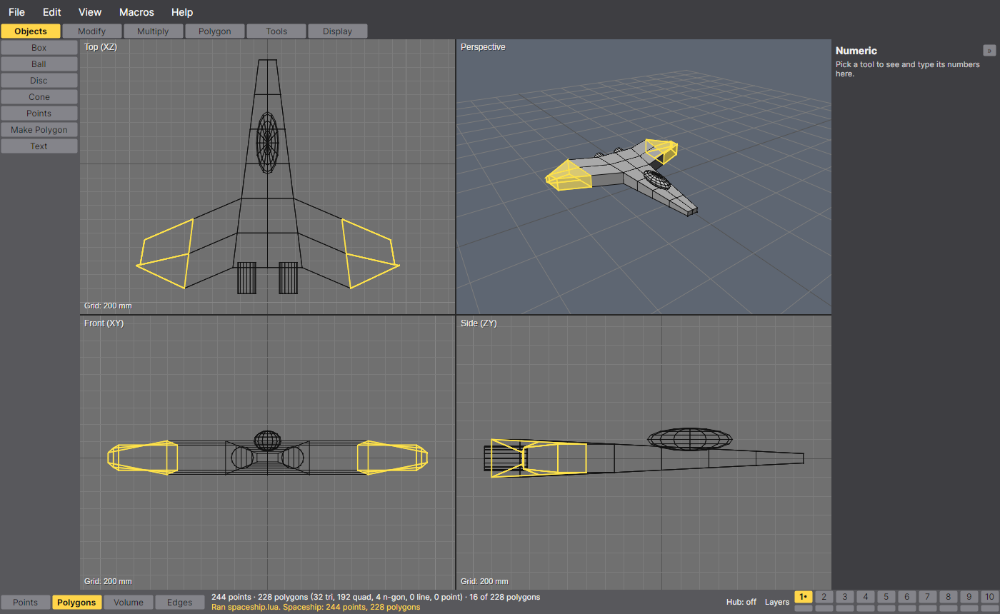

## Features

### The Modeler

- **The quad view**: Top, Front, Side and Perspective, laid out as classic Modeler had them. Double-click a view (or
  press 0) to fill the window with it. The flat views pan and zoom, with a grid that adapts to the zoom and shows its
  size; the perspective view turns, and is shaded with the wireframe on top. Fit all (A) and fit the selection
  (Shift+A).
- **Classic colours**: black wireframe on grey, background layers dimmed, selections in yellow. The modern touches
  are smooth and flat shading, faces seen from behind tinted blue so flipped polygons stand out, and anti-aliased
  lines.
- **Two renderers behind one interface**: a software rasterizer (the default, works everywhere) and OpenGL 3.3 /
  GLES 3 (in Preferences). Both draw the same picture.
- **The mesh**: points and polygons of any number of points, including 1-point polygons (dots) and 2-point polygons
  (lines). LightWave's left-handed space and clockwise winding are kept.
- **Ten layers**: each can be off, in the foreground (being edited) or in the background (shown, and the operand for
  booleans and drills). The buttons along the bottom set them: the top half for the foreground, the bottom half for
  the background, with Shift to add. The number keys do the same.
- **Selection**: Points, Polygons, Volume and Edges modes. Click to pick, drag a box or right-drag a lasso; Shift
  adds and Ctrl removes. You can also invert, select connected, grow and shrink, and from an edge (or two points joined
  by one) select its **loop** (Alt+L: straight on across quads, round a cylinder or along a grid row; a hole's whole
  rim) or its **ring** (Alt+R: the parallel edges across a strip of quads). In Volume mode, drag a box in two
  views to build a 3D volume. As in the original, a tool given an empty selection works on everything. The status
  bar counts points and polygons by type, and selections survive undo.
- **Tools**: each tool has typed parameters, which feed both the numeric panel and dragging in a view, so the two
  stay in step. The preview is live while you drag; Enter keeps the result as one undo step, and Esc cancels. The
  action centre is the selection, the mouse or the origin, and grid snapping is available. Every key can be
  remapped.
- **The classic tabs**:
  - **Objects**: Box, Ball (globe or tessellated), Disc, Cone, Points, Make Polygon, and Text (font outlines, with
    the letters' holes cut in).
  - **Modify**: Move, Rotate, Size, Stretch, Shear, Bend, Twist, Taper, Magnet, Drag, Jitter, Smooth, Center and
    Quantize.
  - **Multiply**: Extrude, Lathe, Mirror, Clone, Array (rectangular and radial), Path Extrude, Rail Extrude, Bevel,
    Smooth Shift, Inset, Chamfer and Bridge.
  - **Polygon**: Flip, Triple, Merge Points, Align, Unify, Remove Degenerate, Select Problems, Subdivide (faceted or
    smooth), Metaform, Surface, Make UVs, Merge Polygons, Split, Loop Cut, Fill Hole and Remove; and Select Loop and
    Select Ring.
  - **Tools**:
    - Boolean against the background layers: Union, Subtract, Intersect and Add.
    - Drill with the background's outline: Core, Tunnel, Stencil and Slice.
    - Cut, copy and paste between layers, and swapping the foreground and background.
- **Edge and face tools** of the modern kind, each leaving a closed mesh closed (the tests run the mesh check after
  every one), with UVs interpolated onto the new points and each run one undo step:
  - **Loop Cut** (Polygon tab, Ctrl+Shift+R): from a selected edge, new edge loops across the strip of quads its ring
    crosses (all the way round a box or a cylinder), splitting every quad. Position (0 to 1) places a single cut, and
    dragging slides it; Count spreads several evenly. Triangles and n-gons at the ends of an open strip take the new
    points into their edges. The new loops are left selected.
  - **Inset** (Multiply tab, I): shrinks the selected faces by Thickness, leaving a border band of quads, and moves them
    Depth along their normals. Individual does each face on its own; Group treats each connected region as one, with
    the band only round its outline: with a Depth, that's a **group bevel**, where the classic Bevel works face by face.
  - **Chamfer** (Multiply tab, Ctrl+B): an edge bevel. Each selected edge (every edge, with nothing selected) becomes a
    strip Width across, flat or rounded along a circular arc in Segments; neighbouring chamfered edges share their
    strips' ends, and a corner where three meet (a box's) is closed with one polygon.
  - **Bridge** (Multiply tab, Ctrl+Shift+B): joins two loops (or chains) of selected edges, two selected faces (removed,
    their outlines joined), or with nothing selected the foreground's two holes, with a band of quads Segments deep.
    Points are paired the way that twists least and the band winds to match its neighbours. Both sides must have the
    same number of points; if not, it says so (and suggests Loop Cut or Subdivide) rather than guess.
  - **Fill Hole** (Polygon tab, Ctrl+Shift+F): closes the holes the selection touches (every hole with nothing
    selected) with one polygon each, triangles, or a ladder of quads, wound against the faces round it. It finds the
    holes with the mesh check's own boundary edges, and Mesh Info's hole row has a Fill Hole button.
- **Mesh Info** (W, View › Mesh Info, or the Display tab): a panel beside the numeric panel that checks the foreground
  layers as you work and says whether the object is a clean solid, ready for 3D printing, booleans and rendering.
  - The verdict: "Closed and printable (1 shell)", or what's wrong ("Open: 1 hole along 32 edges; inconsistent winding:
    4 edges between neighbours facing opposite ways").
  - The numbers: points and polygons by type, the size (in the grid's units, millimetres for small parts, with metres
    beside), the bounds, the surface area, how many separate shells; and for a closed mesh the enclosed volume and its
    centre of mass (even density). The volume is the sum of signed tetrahedra over each face's triangles, positive for
    LightWave's clockwise faces seen from outside.
  - The problems: boundary edges (used by one polygon: the rims of holes, counted as loops), non-manifold edges (used
    by three or more), neighbours wound against each other, closed shells inside out (an inward shell inside another is
    a cavity, a hollow, and is left alone), degenerate polygons (no area, or a point twice), non-planar polygons,
    duplicate and unused points, and 1- and 2-point polygons.
  - Each kind of problem has a **Select** button (the Select Problems tool: edges, polygons or points, in their own
    mode, one undo step so Ctrl+Z puts the selection back) and, where a tool already fixes it safely, a button for it:
    Fill Hole for holes, Align for flipped faces (it makes each piece's winding agree and turns closed pieces outward),
    Merge Points for duplicates, and Remove Degenerate for faces with no area and unused points.
- **Backdrops** (D, View › Backdrop…, or the Display tab), as classic Modeler's Display Options › Backdrop: a reference
  image (a blueprint, a sketch, a photo) behind each flat view, to model over.
  - Each of Top, Front and Side has its own: an image file (PNG, JPEG, BMP and more), its centre in metres on the view's
    two axes (Top X and Z, Front X and Y, Side Z and Y), its width in metres with its height from the image's shape (or
    one of your own, to stretch it), brightness, contrast, opacity, invert, and Show. The panel changes the views as you
    type.
  - It lies in world space on the view's plane, so it pans and zooms with the view and a car's or a rocket's side, front
    and top drawings line up with each other and with the model. Fit All takes it in.
  - It's drawn under the grid and the wireframe, laid over the grey at its opacity (a half unless changed), so the
    wireframe stays readable; both renderers draw it the same. An image that can't be found shows as the magenta
    checker, and the status bar says which.
  - **Fit to Object** centres and sizes it round the foreground layers; **Size from Pixels** makes it as wide as its
    pixels at a size each (5 mm unless changed).
  - Where it's kept: like LightWave 5, which kept backdrops in Modeler's settings rather than the object, it isn't saved
    in the object file (an LWOB stays byte for byte what LightWave writes) and isn't part of the undo history. It stays
    when you start a new object (a new model over the same blueprints), is remembered for each object file in
    `backdrops.json` beside `preferences.json` (images relative to the object's folder, so they move with it) and comes
    back when that object is opened; **Save Setup…** and **Load Setup…** keep a whole setup in a `.json` file of its
    own (images relative to it), to share or reuse.
  - Macros set them with `backdrop()` and AI agents with `set_backdrop`; agents see them in `render_view`.
- **MetaNURBS**: Tab shows the foreground as the smooth (Catmull–Clark) surface of its cage, with the cage drawn in
  blue. Metaform bakes the smoothing into the mesh.
- **Surfaces**: named polygon groups with colour, diffuse, specular, glossiness, luminosity, transparency,
  reflection, smoothing and smoothing angle. They are edited live in the surface editor, and smooth surfaces are
  smooth-shaded in the views.
- **Textures**, the LightWave 5 way: a "T" button beside a surface's colour, diffuse, specular, luminosity,
  transparency, reflection or bump opens its texture panel, where each layer's **Texture type** is an image map (by
  projection) or one of LightWave 5's procedurals. Layers of both kinds stack.
  - An image layer has an image (PNG, JPEG, BMP and more), a projection (planar, cylindrical, spherical, cubic, or UV
    through a named UV map), an axis, a centre and size (with Automatic Sizing to fit the surface), tiling across and
    up (reset, repeat, mirror, edge), wrap amounts for cylindrical and spherical, and opacity and blending (normal,
    additive, multiply).
  - **Procedural textures** are patterns worked out in 3D from where each point is, so they need no image and no UV
    map: Checkerboard, Grid, Dots, Fractal Noise, Marble, Wood, Ripples, Underwater, Crumple, Turbulence, Value and
    Bump Array. Each has LightWave's settings (Frequencies, Contrast, Small Power, Turbulence, Vein Spacing and
    Sharpness, Ring Spacing and Sharpness, Line Thickness, Dot Diameter, Fuzziness, Wave Sources, Wavelength, Wave
    Speed, Band Sharpness, Bump Radius and Spacing), a texture colour (on the colour channel) or texture value (on the
    others) laid over the surface by the pattern's amount, a texture centre, size (one pattern unit: a check's width),
    axis and falloff (fading away from the centre), opacity, blending, Negative and world coordinates. On the bump
    channel the amount is a height: a fractal-noise bump roughens a rock, ripples ruffle water.
  - The noise under them is Ken Perlin's improved noise with his fixed permutation table, so the same object renders
    the same every time, on every machine.
  - The perspective view shows colour textures, images and procedurals, in both renderers (procedurals are worked
    out at every pixel, on the GPU too); Layout's view shows them too, and the ray tracer uses every channel, bump
    included.
  - An image that can't be found or read shows as a magenta checker, and the status bar says which.
- **UV maps**: named per-point UVs, with per-polygon-corner UVs where a seam needs them (as LWO2's VMAP and VMAD).
  - **Make UVs** (Polygon tab) lays out the selection by a planar, cylindrical, spherical, cubic or atlas projection,
    into a new or existing map, cutting seams where a wrap needs them and leaving the neighbours' UVs as they were.
  - **The UV view**: U (or View › UV View) turns the view under the mouse into the current UV map, laid out over its
    texture. Points and polygons are picked there as anywhere, and Move, Rotate, Size and the other tools that move
    points move UVs (one undo step each). View › Next UV Map chooses another map.
  - UVs follow every edit: undo and redo, cut and paste, merging points, and mirror, clone, array, extrude, lathe,
    bevel, smooth shift, subdivide, metaform, triple, split, merge polygons, loop cut, inset, chamfer, bridge and fill
    hole carry or interpolate them. Booleans and drills give each cut face the UVs its source face had at the same
    place.
- **Files**:
  - LightWave objects: LWOB (and the LWLO layered form) read and written; an unchanged object writes back
    byte for byte. Surfaces' textures (CTEX, DTEX, STEX, RTEX, TTEX, LTEX, BTEX and their TFLG, TSIZ, TCTR, TIMG,
    TWRP, TFP0/1, TOPC, TAMP… sub-chunks) are read and written, keeping any sub-chunk this doesn't model; so are
    procedural textures ("Fractal Noise", "Marble"… with TCLR, TVAL, TFAL, TFP0 to TFP3 and TIP0), so the procedurals
    in LightWave 5 objects now draw. UV maps go in LWO2-style VMAP and VMAD chunks, which LightWave 5 skips.
  - LWO2 (LightWave 6 and later) is read only, with its UV maps (VMAP and VMAD), image-map textures (BLOK and CLIP)
    and procedural texture blocks (PROC) of the kinds above, with their colour or value, centre, size, falloff and axis.
  - VideoScape GEO is read and written.
  - Wavefront OBJ is read and written, with its .mtl: texture coordinates (`vt`, faces as `v/vt`) and `map_Kd`,
    `map_Ks`, `map_Ke` and `bump` maps.
  - glTF 2.0 (File › Export glTF…) for game engines, three.js, Blender and the web, as `.glb` (one binary file, images
    inside) or `.gltf` (JSON, its data inside it as base64; agents and the code can also put it in a `.bin` beside it).
    - Written: each layer with faces as a node and mesh, one primitive per surface, triangulated; normals that follow
      each surface's smoothing and smoothing angle (smooth surfaces share normals, flat ones split at every edge);
      a PBR material per surface (colour × diffuse as the base colour in linear light, glossiness as roughness, no
      metal, luminosity as emission, transparency as alpha with blending, double-sided); and the surface's first colour
      image, embedded, with TEXCOORD_0 from the UV map it uses. A planar, cylindrical, spherical or cubic colour map
      is worked out at each corner and written as UVs too, so it looks the same elsewhere. Tiling becomes the
      sampler's wrap mode. A surface with colour procedurals and no image has them baked into a PNG: through its UV
      map (512 × 512) when every face has UVs there, or else as a box map (an atlas of six 256-pixel cells, one per
      side of the surface's bounds).
    - Read: the default scene's nodes with their transforms, each node with a mesh becoming a layer (past the usual
      ten if need be), triangles, strips and fans, points at the same place merged; materials' base colour, alpha,
      emission, roughness and double-sidedness; TEXCOORD_0 as the UV map "UV"; and the base colour texture, from a
      file beside it or from inside the file. A surface is smooth where the file's normals bend across its faces.
    - The space: glTF is right-handed with +Y up, so Z is negated and every triangle's winding reversed, both ways; a
      model faces the same way in both (a test checks a known triangle).
  - STL (File › Export STL…, binary, or ASCII) for 3D printing, and read back (binary or ASCII, told apart by size,
    with duplicate points merged into a joined mesh). Every face becomes triangles with facet normals. STL is Z up, as
    slicers expect, so LightWave's axes go X → X, Y (up) → Z, Z (away) → Y: the model stands on the bed the way it
    stands on the ground in the Modeler, its front toward you, and the winding is reversed to keep faces outward.
  - Image paths are stored relative to the object file where they can be, and looked for from it (and LightWave's
    Images folders beside it), then from the working folder.
  - Recent files, auto-save, and crash recovery: if the app didn't close cleanly, it offers the auto-save back.

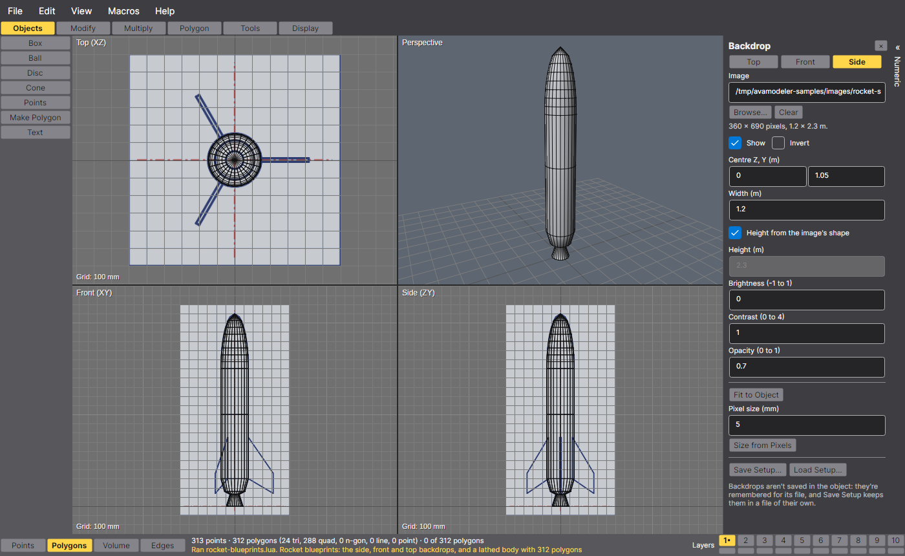

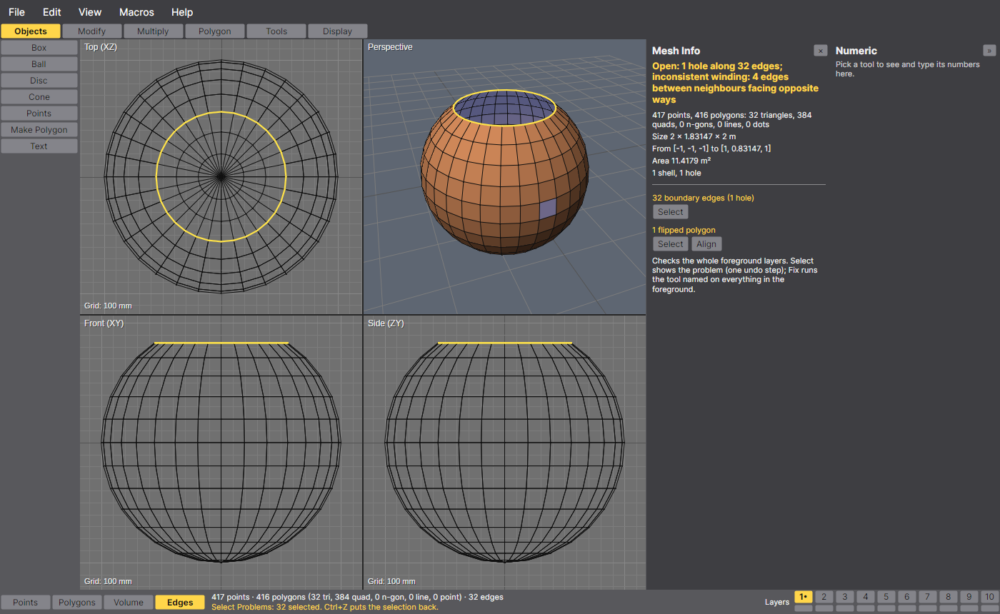

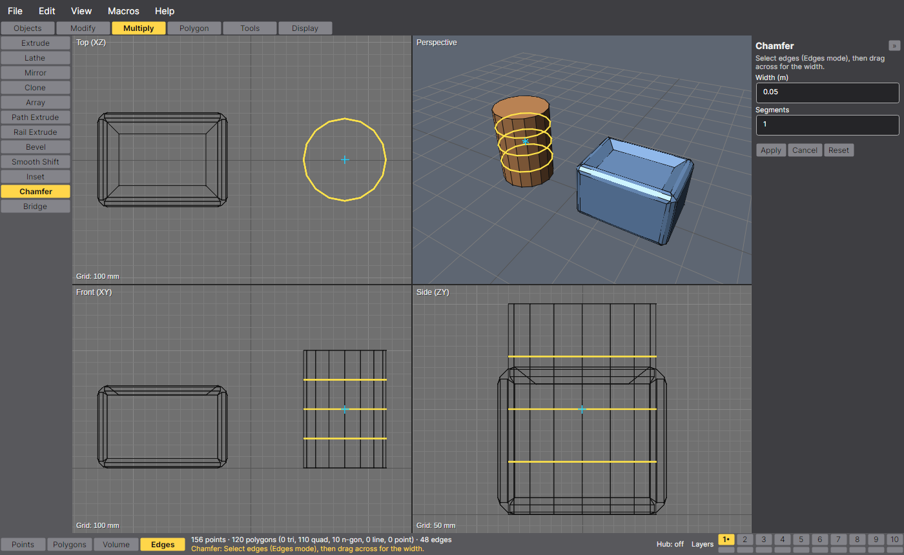

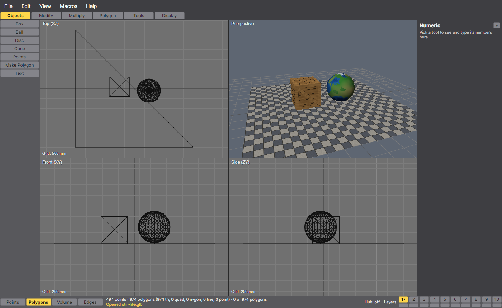

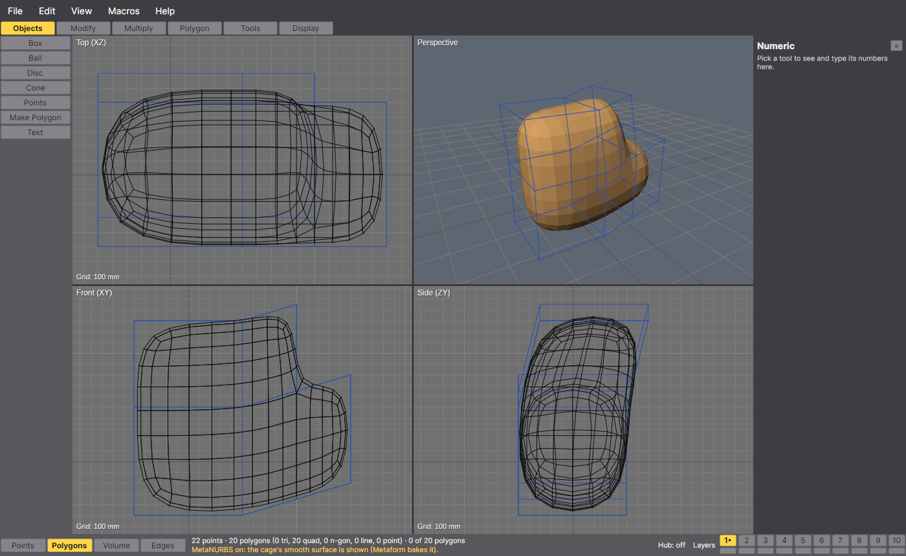

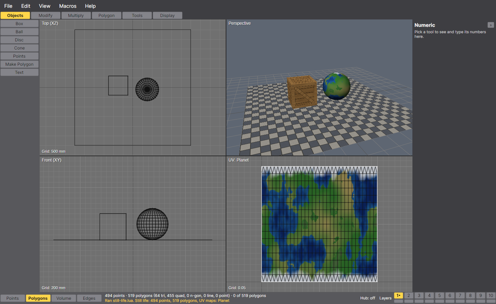

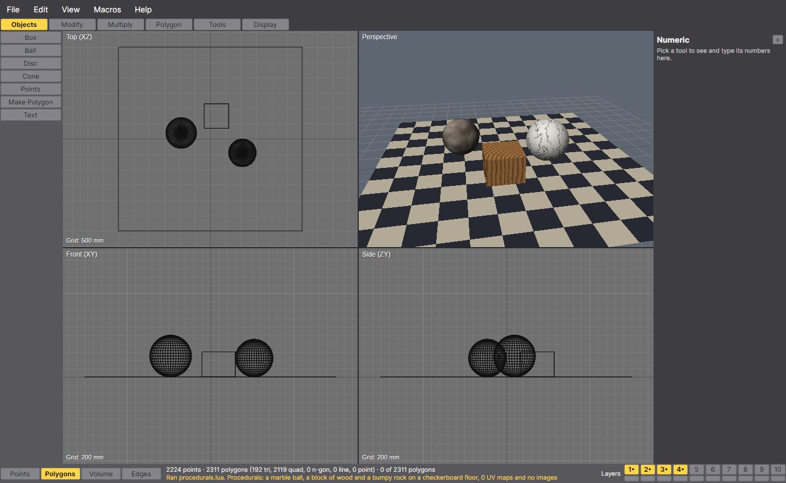

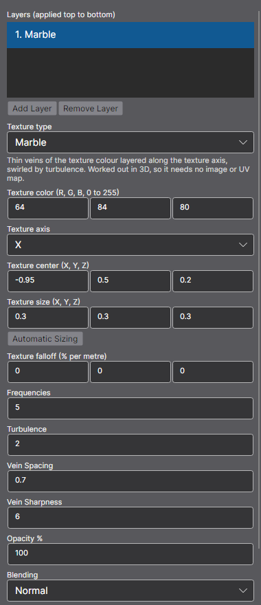

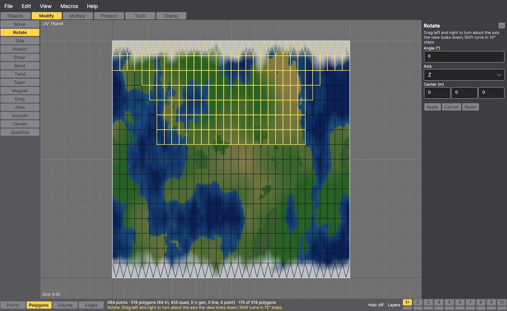

### Macros and plugins

- **Macros** are Lua scripts (through MoonSharp), in the spirit of classic Modeler's ARexx macros.
  - What they can do: run any tool with any parameters, build geometry point by point, select (edges too, with
    `seledges`, and their loops and rings with `selloop()` and `selring()`), set layers, undo,
    make and choose UV maps, texture surfaces (with images, or with procedurals through `proctex()`), and load and save (in any format above, chosen by the extension:
    `save("ship.glb")`, `load("part.stl")`). Macros › Macro Reference lists every command.
  - Samples: `samples/scripts/spaceship.lua` models a classic spaceship from scratch, `logo.lua` makes bevelled
    flying-logo type, and `still-life.lua` builds a crate, a planet and a floor and textures them three ways (cubic,
    UV and planar), with the images in `samples/images` (drawn by `make_textures.py` there). `procedurals.lua` builds a
    marble ball, a wooden block and a bumpy rock on a checkerboard floor with procedural textures alone.
    `rocket-blueprints.lua` puts a rocket's side, front and top blueprints behind the views (drawn by
    `make_blueprints.py` in `samples/images`, with nothing but Python's standard library) and lathes the body over them,
    leaving the fins to you.
  - `checkmesh()` checks the foreground as Mesh Info does and returns a table (`verdict`, `printable`, `volume`,
    `area`, `holes`, `boundary_edges`, `flipped_polygons` and the rest, and `report`, its lines of text), so a macro
    can test its own result: `if not checkmesh().printable then tool("Align") end`.
  ```lua
  tool("Box", { Size = {2, 1, 1}, SegmentsX = 4 })
  selmode("polygons"); selbox(-1, 0.4, -1, 1, 1, 1)
  tool("Extrude", { Offset = {0, 0.5, 0} })
  makeuvs("Wrap", "cylindrical", "y")
  texture("Default", "brick.png", { Projection = "uv", UVMap = "Wrap" })
  proctex("Default", "marble", { Color = {60, 80, 70}, Axis = "x", Size = {0.3, 0.3, 0.3}, VeinSpacing = 0.5 })
  proctex("Default", "fractal_noise", { Channel = "bump", Amplitude = 0.2, Size = {0.1, 0.1, 0.1} })
  ```
  `proctex(surface, kind, {…})` (or `texture()` with a procedural's name in place of the image) sets the channel's
  first layer of that kind; its options are Channel, Color, Value, Size, Center, Axis, Falloff, Opacity, Blend,
  Amplitude, Negative, World, NewLayer, and the kind's settings by name (`Frequencies`, `VeinSpacing`…).
  - `backdrop(view, image, {…})` puts a reference image behind `"top"`, `"front"` or `"side"`: Center (`{a, b}` in
    metres on the view's two axes), Size (its width in metres), Height, Fit (`true`: round the foreground), PixelSize
    (metres a pixel covers), Brightness, Contrast, Opacity, Invert and Visible; `nil` as the image changes the settings
    only, and it returns a note if the image can't be found. `nobackdrop(view)` takes one away (all of them with no
    view). A relative path is looked for from the macro's folder.
  ```lua
  backdrop("side", "../images/rocket-side.png", { Center = {0, 1.05}, Size = 1.2, Opacity = 0.7 })
  backdrop("top", "plan.png", { Fit = true, Invert = true })
  ```
- **Plugins** are .NET assemblies.
  - Any public `Tool` class in one becomes a tool in its tab. An `IModelerPlugin` class can also add file formats
    (loaders and savers).
  - Drop the .dll into the plugins folder (`~/.config/AVAModeler/plugins` on Linux, `%APPDATA%\AVAModeler\plugins` on
    Windows), or load one from Macros › Load Plugin.
  - `samples/StarPlugin` is a working example: a Star generator tool and a point-cloud (.xyz) format.

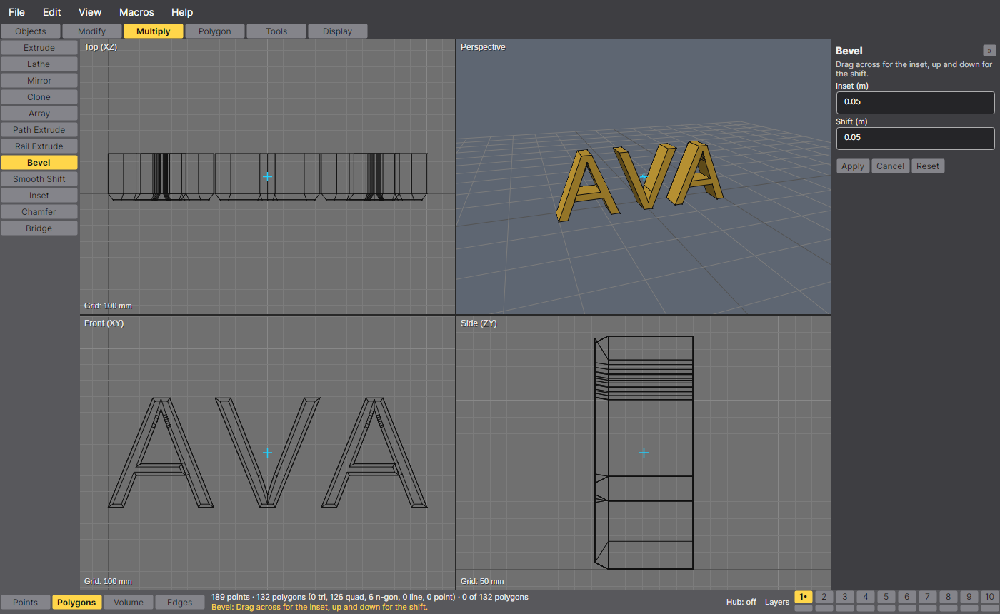

### AI agents

- **An MCP server**: AI agents such as Claude Code drive AVA Modeler through the Model Context Protocol, with the
  same tools and settings a person uses, each step one undo step. They model, and in Layout they stage, light,
  animate (morphs, displacements and bones from skelegons included) and ray-trace scenes, and render animations
  into MP4 and GIF movies. Saved recipes (MCP prompts) give them step-by-step plans to start from. `AVAModeler --mcp` works headless on a model and scene of its own; with Macros › Allow
  AI Agents on, an agent can also build in the open window while you watch. See
  [Driving AVA Modeler from an AI agent](#driving-ava-modeler-from-an-ai-agent).

- **AI Chat inside the app** (F4, or Macros › AI Chat): a panel on the right where you ask Claude for something
  ("make a chess pawn", "put it in a scene with a spotlight and render it") and watch it build with the same tools,
  with no outside client. It can also run on a local or self-hosted model (Ollama, LM Studio, vLLM, llama.cpp, or a
  company gateway) through an OpenAI-compatible API, so nothing need leave the machine. See
  [The AI Chat panel](#the-ai-chat-panel).

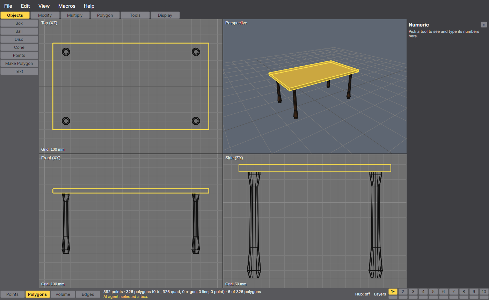

### Layout

Layout (F2, or View › Layout) is the second workspace. It shares the object you're modeling live: change it in the
Modeler and Layout shows the change at once.

- **The scene**: objects, nulls, lights, cameras and bones, each with a parent and a pivot. Objects can also be
  loaded from files.
- **Animation**: a key per channel, interpolated by Kochanek–Bartels TCB splines as classic LightWave did.
  - With Auto key on, moving or turning an item in the view keys it at the current frame. An item's first key
    replaces its starting value, so its motion begins at the first frame you key. AI agents' keys follow the same rule.
  - Delete Key leaves a channel's only key, which holds its value.
  - The timeline plays, steps, and shows the chosen item's keys.
  - **The dope sheet** (D, or View › Dope Sheet, in the graph editor's place): every item as a row against the frames
    (and with Channels, each keyed channel as a row of its own), each key a diamond. Click a key to choose it,
    Shift-click to add or take one away, or drag a box round several; drag the chosen keys sideways to move them in
    time, snapped to whole frames (a key they land on is replaced). Delete removes them (a channel's last key stays),
    Ctrl+C and Ctrl+V copy them and paste them at the current frame onto the same channels, Ctrl+A chooses them all,
    the arrow keys nudge them a frame, and Scale × stretches or squeezes their timing about the earliest. Clicking the
    frame numbers moves to that frame. Each change is one undo step, and keys keep their values and TCB settings.
  - The graph editor shows the channels as curves. Choose a key to set its value, tension, continuity, bias and
    linear flag, and set what happens before the first key and after the last.
- **Undo**: Ctrl+Z (Edit › Undo) takes back the last change to the scene, and Ctrl+Shift+Z or Ctrl+Y (Edit › Redo)
  does it again, up to 100 steps. The Edit menu names the step ("Undo Move Camera"). A drag in the view or the graph
  editor is one step, as are a value typed and entered, Create Key, Delete Key, adding or removing an item, Skelegons →
  Bones, parenting, the scene settings, each change in the dope sheet (a drag of keys, a paste, a scale), and each IK
  and path setting, Bake IK and Bake path. AI agents' scene changes are steps on the same history ("Agent: added a
  light"), so your Ctrl+Z takes them back too. New Scene and Load Scene clear it. The object's geometry has the
  Modeler's own undo.
- **Cameras and lights**: the light view (View › Light) looks through the chosen light, or the first, as classic Layout's
  did for aiming spots (a spot's cone wide). The camera view with its picture shape and its action- and title-safe areas, turned by the
  camera's heading, pitch and bank (a banked camera's view tilts just as its ray-traced picture does); zoom factor
  and field of view, and, off until switched on, depth of field (focal distance and LightWave's lens f-stop, with a
  Focus on button that brings a chosen item into focus) and motion blur (the shutter as a fraction of a frame).
  Distant, point, spot and area lights have colour, intensity, cone, soft edge, range and shadows; an area light is
  a rectangle of a size you give, and a point or spot light can have a radius, both casting soft shadows. Layout's
  views draw an area light's rectangle and a soft light's size.
- **Scene files**: classic LightWave .lws scenes (LightWave 4 and 5, and later versions) are read and written, and
  there is a native .avascene format (JSON) that keeps everything, meshes included.
- **glTF export** (Scene › Export glTF…): the scene as `.glb` or `.gltf`, its objects, nulls, cameras and lights
  (KHR_lights_punctual) as nodes in their parent hierarchy, converted to glTF's right-handed +Y up space, and keyed
  position, rotation and scale as one animation, sampled at every frame of the scene's range.
- **Rendering**: an offline CPU ray tracer, multithreaded and deterministic.
  - Shading: Phong with glossiness, luminosity, smoothing within each surface's angle, reflection, and transparency
    with refraction.
  - Textures: image layers on every channel, filtered bilinearly between mipmap levels (trilinear) so distant
    textures don't shimmer, and bump maps that tilt the shading by the image's slope. Procedural layers on every
    channel too, worked out in 3D at each hit in the object's coordinates (or the world's), with procedural bumps
    tilting the normal by the pattern's slope (by finite differences): amplitude 1 tilts it 45° where the amount
    rises by 1 over one texture size.
  - Lights and backdrop: ray-traced shadows with soft-edged spots, ambient light, a gradient backdrop, and fog.
  - Antialiasing, and saving to PNG with or without alpha.
  - Render effects, each off until switched on, so a scene renders exactly as before unless you ask (a test checks
    that, pixel for pixel), and each repeatable: the same scene renders the same picture on any number of threads.
    - **Ambient occlusion** (Scene › Scene Settings): the ambient light dims where nearby surfaces hide it, so creases,
      corners and the ground under things darken. Samples, distance (metres) and strength.
    - **Soft shadows**: area lights (a rectangle in the light's XY plane, shining from its front, sized in metres and
      scaled with the item, as LightWave sizes area lights), and point and spot lights with a radius. Shadow samples
      per light.
    - **Environment** (Scene Settings): a latitude-longitude picture round the scene, a Radiance `.hdr` (high dynamic
      range, read by a small reader of its own, flat or run-length encoded) or a PNG, JPEG or BMP, or the built-in
      `builtin:sky` and `builtin:studio`. It replaces the backdrop, shows in reflections and through glass, turns by a
      heading and scales by an intensity, and can light the scene as soft light from every direction, shadowed by
      what's in the way. `samples/images/studio.hdr` is a studio drawn by `make_environment.py` beside it.
    - **Depth of field** (the camera): a thin lens, as LightWave 5's was: the focal length is the zoom factor × 7.5 mm
      and the opening that over the f-stop, so small f-stops (0.1 to 0.5) blur strongly at scene scale.
    - **Motion blur** (the camera): each pixel's rays spread over the shutter, centred on the frame, so what moves
      (items, the camera, bones, morphs and displacements, lights) smears along its path; Render Animation and
      `render_animation` honour it.
    - Samples are counted per pixel. Depth of field and motion blur need a ray per lens point or moment, so they raise
      the rays a pixel to their samples (when more than the antialiasing's). Ambient occlusion, environment lighting
      and soft shadows are worked out where each ray hits, sharing their count among the pixel's rays, stratified (a
      shifted Hammersley set per pixel) so the pixel covers it evenly. The environment's lighting counts only the light
      that's hidden from a point (against a table of what each facing gets from the whole sky), so open surfaces come
      out without noise. A 320 × 240 frame of a test scene that takes 1.7 s plain (4 rays a pixel, 8 threads) takes
      2.4 s with ambient occlusion, 3.2 s with environment lighting, 2.4 s with an area light (16 samples each), 5.3 s
      with depth of field and 5.1 s with motion blur (16 rays a pixel), and 10 s with all of them.
  - Render › Render Animation (F10) renders a run of frames, with a step, into numbered PNGs (`frame0001.png`…), in
    `<scene>_frames` beside the saved scene by default. Each frame shows as it finishes, with the time left and a
    Cancel button; you can go on working while it renders, as it renders a copy of the scene. If
    [ffmpeg](https://ffmpeg.org) is on the PATH, it also joins the frames into an MP4 (H.264) and a looping GIF.
- **Deformation**: bones bend objects, weighted by distance as classic LightWave's were. Skelegons in the Modeler
  turn into bones. Morph targets blend by envelope, and there is wave and ripple displacement.
- **Following a path** (the Path section of any item's settings but a bone's): the item travels along a smooth curve
  (a centripetal Catmull–Rom spline, which doesn't overshoot) through other items, usually nulls placed for it, in
  the item list's order, open or **closed** into a loop; move or animate a null and the path changes with it. Where
  along it the item is, from 0 at the start to 1 at the end (a loop's positions wrap round, so 2 is twice round), is
  a channel of its own, `path.position`, keyed like any other (in the panel, the graph's keys, the dope sheet, and
  agents' `set_key`), measured evenly along the curve's length; **Even speed** keys it once round from the first frame
  to the last. **Align to path** turns its heading and pitch to face along the curve (looking a **look-ahead** in
  metres ahead, or along the tangent), as LightWave's Align to Path did; **Banking** leans it into turns (degrees on
  a 1 m radius turn, less on wider ones). The view draws the path. **Bake path** turns the motion into ordinary
  position and rotation keys.
- **Inverse kinematics** (a bone's settings in the item panel), as LightWave 5 had it: give the bone at the end of a
  chain a **goal** (a null, or any item that doesn't ride on the chain) and the chain (that bone and its parent bones,
  up to one marked **Anchor**, LightWave's "unaffected by IK of descendants") turns so its tip reaches it. With
  **Full-time IK** on, it follows the goal at every frame, in the views, renders, deformation and exports; off, the
  bones play their keys, and **Key IK here** keys the chain's IK pose at the frame (move the goal, then key, as in
  LightWave 5). Each bone can **limit** its heading, pitch and bank (minimum and maximum degrees) and **lock** any of
  them (IK leaves it at its keys). **Bake IK** keys the solved rotations at every frame and turns full-time IK off. A
  goal beyond reach leaves the chain stretched straight toward it. The view draws a line from the bone's tip to its
  goal. The solver is cyclic coordinate descent in each bone's own heading, pitch and bank, starting every frame from
  the keyed pose, so it gives the same answer every time.

### AVALightWave and the hub

[AVALightWave](https://github.com/Harlock123/AVALightWave) is a standalone re-imagining of classic LightWave Layout
built on this engine, as the original package had a modeler and a separate Layout joined by a hub. AVA Modeler is on
the hub unless you turn it off (Edit › Preferences › Link with AVALightWave): a live link over a local pipe that only
your own programs can open (no network).

- **Edit in Modeler** in AVALightWave opens one of its scene's objects here (starting AVA Modeler if it isn't running).
  It won't open over unsaved work: save or discard it, and try again.
- **Saving** that object (Ctrl+S) updates it in AVALightWave's scene at once, keeping its motion; so does saving any
  object AVALightWave's scene uses.
- **File › Send to AVALightWave** puts the open object in AVALightWave's scene (a saved object by its file, an unsaved
  one as a copy in the `hub` folder beside `preferences.json`); sent again, it updates the same scene object. If
  AVALightWave isn't running it's started with the object (found beside AVA Modeler, in a folder beside it, on the PATH,
  through `AVALIGHTWAVE_PATH`, or where Preferences says).
- Either program works alone: when the other isn't there, nothing waits more than a moment.

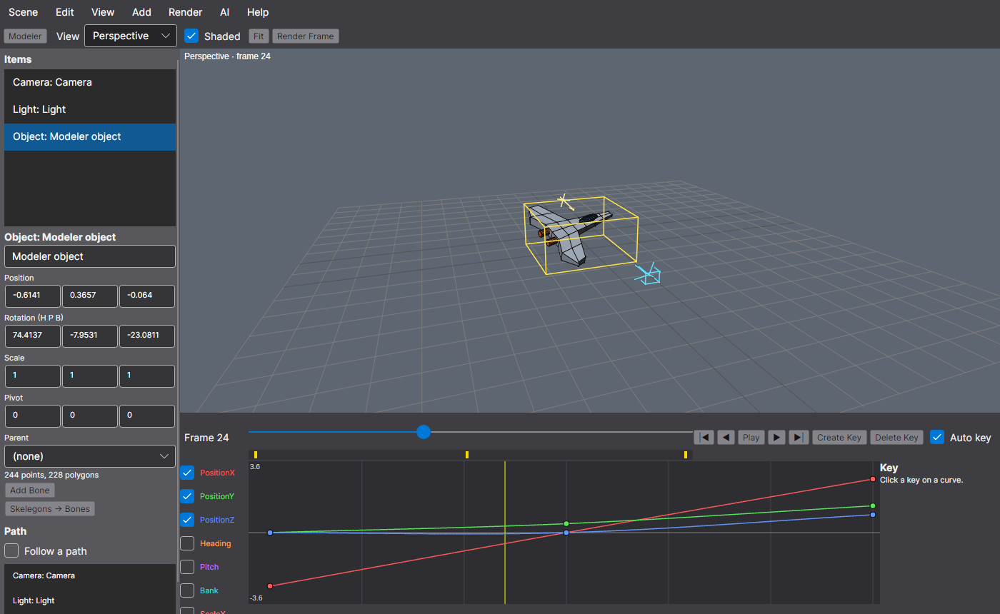

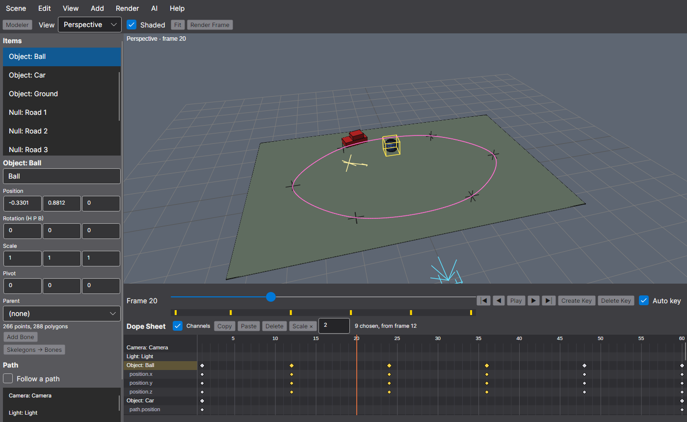

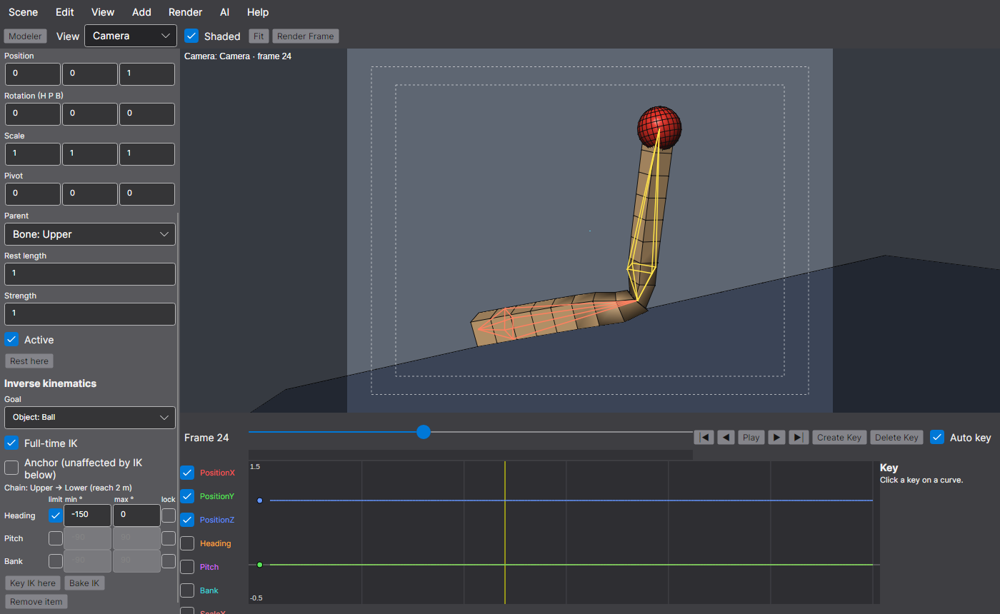

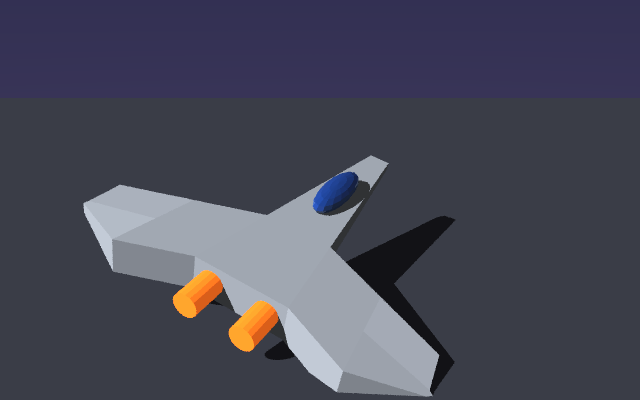

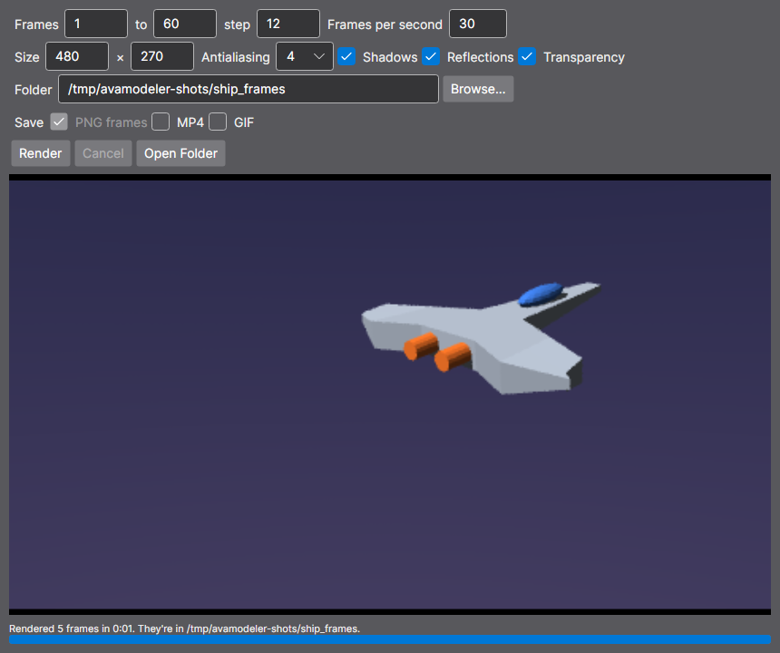

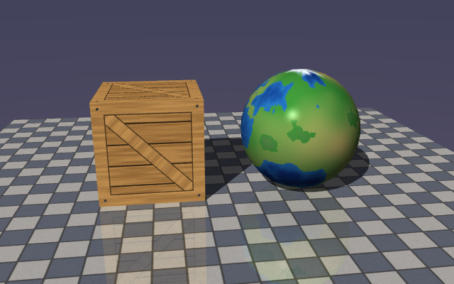

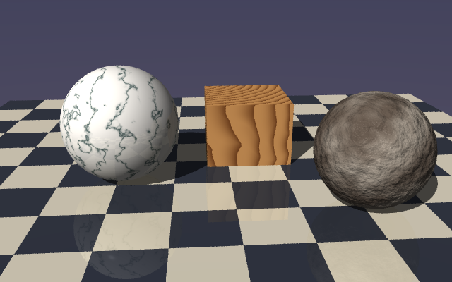

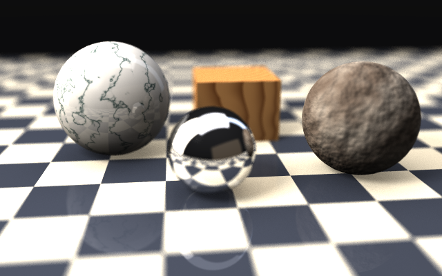

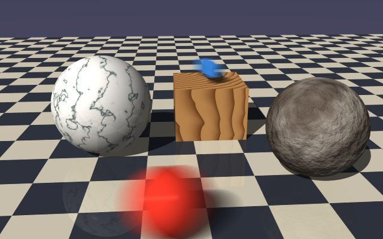

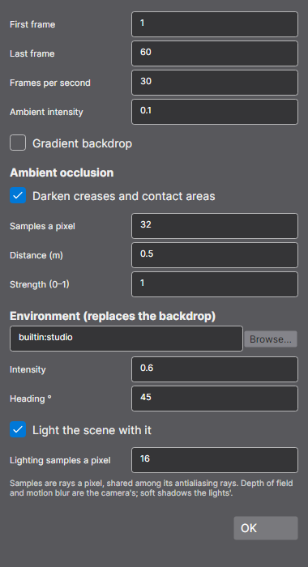

## Download and run

Ready-to-run builds for Windows, macOS and Linux, on both Intel/AMD and ARM, are on the
[Releases page](https://github.com/Harlock123/AVAModeler/releases/tag/latest). **Latest build** is rebuilt on every
push to `main`. Each download is one self-contained executable: no .NET install is needed.

| Platform | Archive |
|---|---|
| Windows | `AVAModeler-win-x64.zip`, `AVAModeler-win-x86.zip`, `AVAModeler-win-arm64.zip` |
| macOS | `AVAModeler-osx-arm64.tar.gz` (Apple silicon), `AVAModeler-osx-x64.tar.gz` (Intel) |
| Linux | `AVAModeler-linux-x64.tar.gz`, `AVAModeler-linux-arm64.tar.gz`, `AVAModeler-linux-arm.tar.gz` |

```bash
tar -xzf AVAModeler-linux-x64.tar.gz     # or linux-arm64, linux-arm, osx-arm64, osx-x64
./AVAModeler                             # or ./AVAModeler spaceship.lwo
```

On Windows, unzip and run `AVAModeler.exe`. On macOS, if Gatekeeper refuses to open it, run
`xattr -d com.apple.quarantine AVAModeler` once.

## Using it

| | Mouse | Keys |
|---|---|---|
| Select | Click; drag a box; right-drag a lasso (Shift adds, Ctrl removes) | Space cycles Points / Polygons / Volume / Edges; `/` deselect; `'` invert; `]` connected; Alt+L the edge loop, Alt+R the edge ring |
| Use a tool | Pick it from the tab (or its key), then drag in a view; Shift keeps to one axis | Enter keeps the result, Esc throws it away; N folds the numeric panel to a strip and back (View › Numeric Panel, or its » button) |
| Navigate | Wheel zooms; middle-drag or Alt-drag pans; drag the perspective view to turn it; double-click to maximize | A fit all, Shift+A fit selected, `.` and `,` zoom, 0 maximize, U the UV view |
| Layers | The layer buttons (top half foreground, bottom half background) | 1–9 foreground, Shift adds, Alt background, `\` swaps |
| Backdrops | View › Backdrop…, or the Display tab | D the Backdrop panel |
| Edit | | Ctrl+Z undo, Ctrl+Shift+Z redo, X cut, C copy, Ctrl+V paste, Delete remove; in Layout, Ctrl+Z undoes the scene, Ctrl+Shift+Z or Ctrl+Y redoes |
| Workspaces | | F1 Modeler, F2 Layout, F4 the AI Chat panel, F9 render a frame and F10 an animation (in Layout) |
| Dope sheet (Layout) | Click a key, Shift-click to add, drag a box; drag keys to move them in time; click the frame numbers to go there | D shows it (or the graph editor again); with it focused, Delete, Ctrl+C, Ctrl+V (at the current frame), Ctrl+A, and ← → to nudge a frame |
| Files | File › Send to AVALightWave (the hub) | Ctrl+N new, Ctrl+O open, Ctrl+S save, Ctrl+Q quit (File › Quit) |

The default tool keys follow the classic layout: T Move, Y Rotate, H Size, Shift+H Stretch, Shift+X Box, Shift+O
Ball, Shift+C Disc, P Make Polygon, F Flip, M Merge Points, E Extrude, L Lathe, V Mirror, B Bevel, Tab MetaNURBS, and
W Mesh Info (LightWave's Statistics key), D Backdrop (where LightWave's d opened its Display Options). The newer tools take Blender's keys where they are free: I Inset, Ctrl+B
Chamfer, Ctrl+Shift+R Loop Cut (Ctrl+R is Drill here), and Ctrl+Shift+B Bridge and Ctrl+Shift+F Fill Hole.
Help › Keyboard lists them all, and Edit › Preferences changes any of them.

## The AI Chat panel

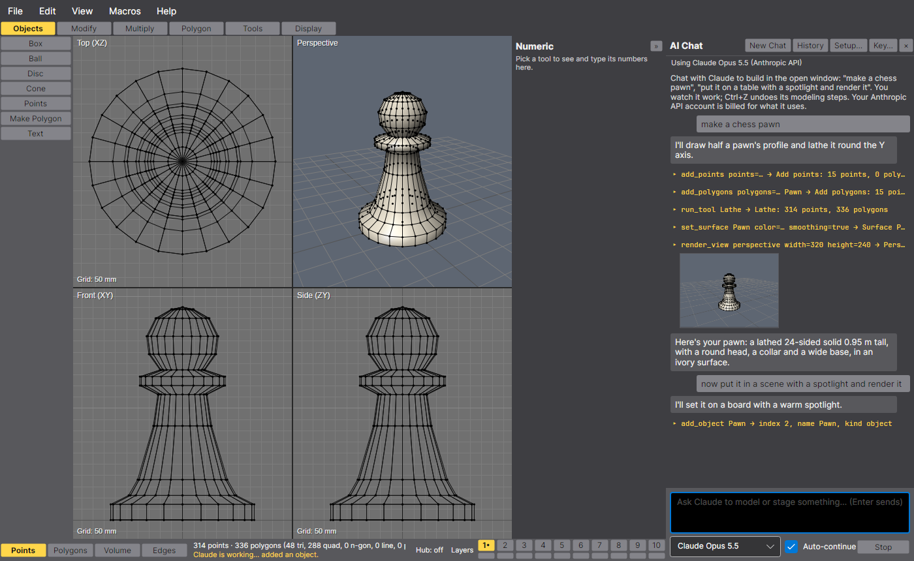

**F4** (or Macros › AI Chat in the Modeler, AI › Chat in Layout) opens a chat with Claude on the right of the window,
beside whichever workspace is on screen. Ask for something to model or stage, and Claude builds it in the open window
while you watch, with the same tools an outside agent gets through MCP (the app runs its own MCP server in-process, so
nothing listens anywhere and Macros › Allow AI Agents needn't be on).

- **What it shows**: your messages, Claude's replies as they're written, and each tool call as a compact line
  (`▸ run_tool Lathe → Lathe: 314 points, 336 polygons`); click a line to see its full input and result. Pictures
  Claude renders to check its work show as thumbnails.
- **Typing**: Enter sends, Shift+Enter starts a new line. Send becomes **Stop** while Claude works, and stops it at
  once, even while a call is waiting for you. **New Chat** starts a new conversation. The status bar says "Claude is
  working…" and what it just did.
- **History**: with **Keep chat history** ticked (in the panel's History, or Edit › Preferences), each conversation is
  saved on this computer after every request and when the app closes, and the last one opens again when the app
  starts, so you can carry on where you left off. **History** lists the saved chats, newest first, with their model,
  date and length: click one to open it (the one on show is saved first), **Export…** writes it as a Markdown file
  (the person's and the model's words, each tool call with its input, and the pictures in a folder beside it),
  **Delete** removes it, and **Clear History** removes them all. **Export This Chat…** exports the one on show
  whether or not history is kept.
  - Where: one JSON file a chat in the `chats` folder beside `preferences.json`, its pictures in a folder of its own,
    files readable only by you on Linux and macOS. No API key is ever written there (a chat keeps its provider, its
    model and a server's host and port only).
  - Pictures: each is kept once, by its contents, up to 2 MB a picture and 16 MB a chat; beyond that it's left out and
    the chat says so.
  - Off by default: a chat may hold a client's names, files or designs, so nothing is saved until you tick it. Turning
    it off stops saving; what's saved stays until you delete it or press Clear History.
  - A saved chat carries on with the same provider: its messages are sent again in that provider's own format. A chat
    saved with Claude, opened while the chat uses a local server (or the other way round), is shown read-only, with a
    New Chat button; choose its provider again in Setup… and it carries on.

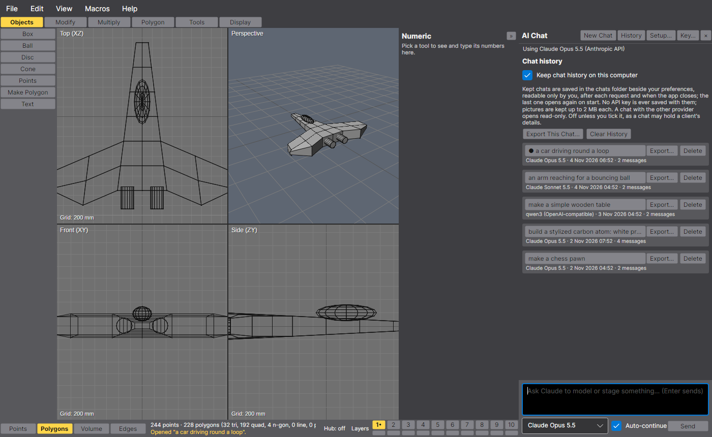
- **Undo**: each tool call is one undo step, so Ctrl+Z takes Claude's modeling back step by step. If you have a tool
  armed or a dialog box open, Claude's calls wait (up to 20 seconds) for you to finish.
- **Models**: Claude Opus 5.5 (`claude-opus-5-5`, the default and the most capable), Claude Sonnet 5.5
  (`claude-sonnet-5-5`) and Claude Haiku 4.5 (`claude-haiku-4-5-20251001`), quicker and cheaper.
- **The key**: it needs an Anthropic API key (from [console.anthropic.com](https://console.anthropic.com)). Set the
  `ANTHROPIC_API_KEY` environment variable before starting AVA Modeler, or press **Key…** in the panel and paste one:
  it's kept in `anthropic-api-key` beside `preferences.json` (`~/.config/AVAModeler` on Linux,
  `%APPDATA%\AVAModeler` on Windows), readable only by you on Linux and macOS, and sent only to the Anthropic API.
  The environment variable wins over a saved key. The app never shows the key again in full (only `sk-ant-…1234`).
  Without a key the panel says how to set one.
- **Cost**: the requests go to your own Anthropic API account, which is billed for them. The system prompt and the
  tool definitions are marked for prompt caching, so a conversation's later requests cost much less to send. A busy
  modeling session with Opus and pictures can still use a fair number of tokens.
- **Errors**: no connection, a refused key (401), rate limits (429) and an overloaded API show as a line in the chat
  with a **Retry** button.
- **Long jobs**: one request pauses every 60 tool calls. With **Auto-continue** ticked (beside the model; on unless
  you untick it, and remembered) Claude carries on by itself, saying so in the chat, up to 600 calls in all.
- **Which model**: the line under the panel's title says what it's using ("Using Claude Opus 5.5 (Anthropic API)", or
  "Using qwen3 on localhost:11434 (OpenAI-compatible, core tools)"). **Setup…** chooses the provider: Claude, or a
  local or self-hosted model (below). The choice is kept in Preferences (Edit › Preferences has it too); changing
  provider starts a new chat, since a conversation can't move between them.

### A local or self-hosted model

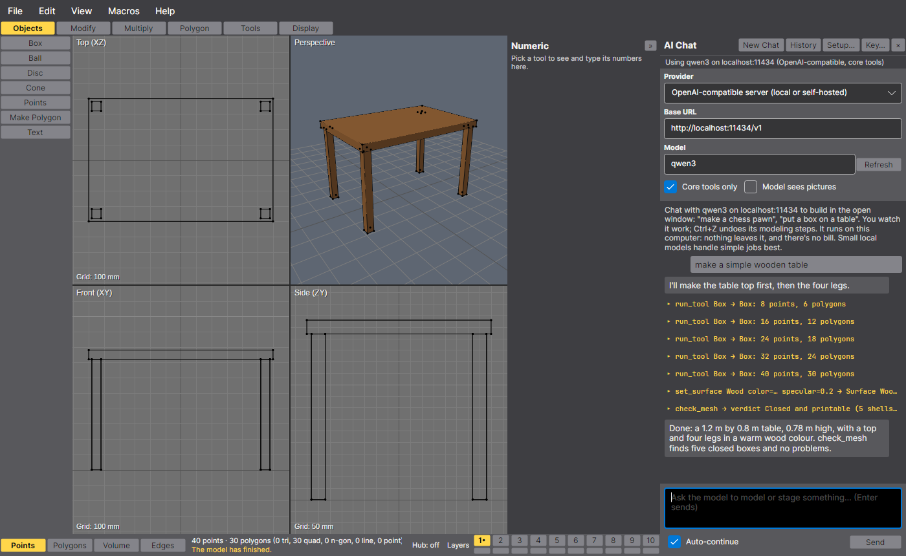

The chat can also talk to any server that speaks the OpenAI Chat Completions API: [Ollama](https://ollama.com)
(its `/v1`), LM Studio, vLLM, llama.cpp's `llama-server`, or a company's own gateway. The model gets the same MCP
tools and the same system prompt, and builds in the open window the same way: the same model-agnostic tools, with the
model running where the data lives. With a server on your own computer nothing leaves the machine, there's no API bill,
and it works offline.

- **Ollama**: install it, fetch a model that can call tools, and give it room for the tool definitions and system
  prompt, which need more than Ollama's default context:

  ```bash
  ollama pull qwen3                  # or qwen3:14b, llama3.1, mistral-small, qwen2.5…
  OLLAMA_CONTEXT_LENGTH=32768 ollama serve
  ```

  In the chat press **Setup…**, choose **OpenAI-compatible server**, leave the base URL at
  `http://localhost:11434/v1`, and type the model's name (`qwen3`), or press **Refresh** to list the models the server
  has and pick one.
- **LM Studio**: start its server (Developer › Start Server), load a model, and use `http://localhost:1234/v1`.
  llama.cpp's `llama-server --jinja` is at `http://localhost:8080/v1`; vLLM (started with tool calling on) at
  `http://localhost:8000/v1`.
- **A gateway**: put its base URL in and press **Key…** to enter its API key, if it asks for one. The key is kept like
  the Anthropic key, in a file of its own (`openai-compatible-api-key` beside `preferences.json`, readable only by you
  on Linux and macOS), sent only in the Authorization header to that server, and only ever shown masked. A server on
  `localhost` needs no key.
- **Core tools only** (on unless you untick it): small models choose much better among fewer tools, so the chat
  offers them 23 of the 75 instead of all of them: `run_tool` (any Modeler tool by name, with `list_tools` and
  `describe_tool`), `add_points` and `add_polygons`, a few selection commands, layers, undo, new and save, surfaces,
  `get_document`, `check_mesh`, `render_view`, and the main scene tools (`get_scene`, `add_object`, `add_light`,
  `set_transform`, `look_at`, `set_key`, `render_scene`). Untick it for a large model on a gateway.
- **Model sees pictures** (off unless you tick it): tick it for a vision model (qwen2.5vl, gemma3, llama3.2-vision…)
  and the pictures it renders go back to it as images, in a message after the tool's result. Otherwise the panel
  still shows you the pictures, and the model is told one was made and to check its work with `get_document` and
  `check_mesh` instead.
- **What to expect**: a small local model handles simple jobs (a box, a table, a lathed vase) but is far less
  reliable than Claude at long multi-step work: it may call a tool with wrong arguments (the error goes back to it, as
  it would to Claude), lose track of what it built, or stop early. Bigger models (14B and up) do noticeably better.
  The tool-call limit, Auto-continue, Stop, Retry and Ctrl+Z work the same way. Prompt caching is Anthropic's, so it
  isn't used here.
- **Errors**: a server that isn't running, a wrong base URL, a model that isn't downloaded (404), a model without tool
  support, or a refused key each show as one plain line with **Retry**.
- **Network**: the chat contacts only the base URL you set, for `…/chat/completions` and (when you press Refresh)
  `…/models`. Nothing else, and no telemetry.

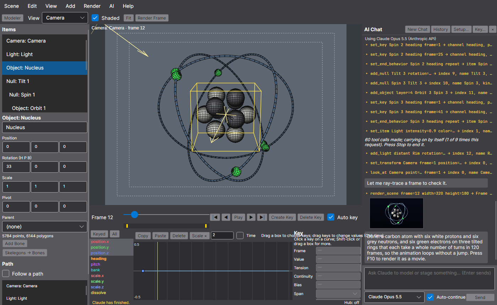

A whole job from one sentence: asked for "a stylized carbon atom: white protons, grey neutrons, and green electrons
whizzing round the nucleus", Claude models the nucleus and three orbit rings in separate layers, then stages them in
Layout: a 120-frame loop, the nucleus keyed to turn once, each ring spinning under a tilted null, a rim light and the
camera aimed with `look_at`. That's over 60 calls, so Auto-continue carries it on past the pause; then it ray-traces
a frame to check its work. (The picture is drawn by the test suite with the sample's own calls, played by a stand-in
for Claude.)

## Driving AVA Modeler from an AI agent

AVA Modeler is an [MCP](https://modelcontextprotocol.io) server, so an AI agent (Claude Code, or any MCP client) can
model with it the way a person does: it runs the same tools with the same parameters, through the same command layer
the menus and Lua macros use, and every step is one undo step. It can then put what it modeled in a Layout scene,
light it, animate it and render it. It doesn't move the mouse or click: it calls the tools. It sees its work by asking
for pictures of the views, Layout's view, or ray-traced frames.

There are two ways to run it, both from the same program:

- **Headless**: `AVAModeler --mcp` serves MCP on stdin and stdout with no window. The agent's client starts it as a
  command; it has an object and a scene of its own and saves files in its working folder.
- **Live**: `AVAModeler --mcp --attach` connects the agent to the AVA Modeler open on your desktop. Everything it
  does happens in the open object and in Layout's scene: you watch it appear in the views, your edits and its edits
  to the object share one undo history, and Ctrl+Z undoes its steps (in Layout, its scene steps). Its scene changes go to Layout's scene whether or
  not Layout is on screen (the window isn't switched for you; F2 shows it), and Layout's item list follows them. Turn it on with **Macros › Allow AI Agents (MCP)** (or in Edit › Preferences;
  it's off until you do). The app then listens on a local pipe (a Unix domain socket on Linux and macOS, a named pipe
  on Windows) that only your own user account can open, so nothing on the network or from another account can
  connect. If the app isn't open, or agents aren't allowed, the agent's calls say so and say how to turn it on; the
  bridge reconnects by itself once the app is there. While you have a tool armed or a dialog box open, an agent's call
  waits (up to 20 seconds) for you to finish rather than change things under you.

Options: `--root FOLDER` sets the working folder (the current folder by default), which `open`, `save`, the scene
files and texture paths start from; files stay inside it, only formats AVA Modeler knows are read and written, and a
file is never written over unless asked to. `--no-plugins` skips the plugins folder.

### Setting up Claude Code

Use the downloaded program (or a build: `dotnet build -c Release`, then `src/AVAModeler/bin/Release/net10.0/AVAModeler`).
Don't use `dotnet run` for an MCP server: it prints build messages to the same stream.

```bash
claude mcp add avamodeler -- /path/to/AVAModeler --mcp                  # headless
claude mcp add avamodeler-live -- /path/to/AVAModeler --mcp --attach    # the open app
```

Or, for everyone working in a folder, in its `.mcp.json`:

```json
{
  "mcpServers": {
    "avamodeler": { "type": "stdio", "command": "/path/to/AVAModeler", "args": ["--mcp"] },
    "avamodeler-live": { "type": "stdio", "command": "/path/to/AVAModeler", "args": ["--mcp", "--attach"] }
  }
}
```

### The tools an agent gets

| Tool | What it does |
|---|---|
| `list_tools`, `describe_tool` | Every modeling tool (built in and from plugins) by tab, and one tool's parameters: type, default, unit, limits, choices. Both come from the tools themselves. |
| `run_tool` | Runs a modeling tool with parameters by name, on the selection (or everything in the foreground), as one undo step; returns the point and polygon counts before and after, and the selection. |
| `add_points`, `add_polygons` | Builds geometry point by point in the current layer. |
| `set_selection_mode`, `select_points`, `select_polygons`, `select_box`, `select_all`, `select_none`, `select_invert`, `select_connected` | The selection. |
| `select_edges`, `select_loop`, `select_ring` | Edges by their two points, then the edge loop or ring through them: what Loop Cut, Chamfer, Bridge and Fill Hole (all through `run_tool`) start from. |
| `set_layers` | The foreground and background layers. |
| `copy_layer` | Copies a layer into an empty one, points in the same order: the start of a morph target. |
| `undo`, `redo`, `new`, `open`, `save` | The history and files: `.lwo`, `.obj`, `.geo`, `.glb`, `.gltf` and `.stl` (and plugin formats), chosen by the extension; `save` takes `ascii` for text STL and `separate_bin` for a `.gltf` with a `.bin` beside it. |
| `set_surface`, `set_texture`, `remove_textures`, `make_uvs`, `set_uv_map` | Surfaces, image textures and UV maps. |
| `set_procedural` | A LightWave 5 procedural texture on a surface's channel (checkerboard, grid, dots, fractal_noise, marble, wood, ripples, underwater, crumple, turbulence, value, bump_array) with its colour or value, size, centre, axis, falloff and settings by name: no image file or UV map needed. |
| `run_lua` | Runs a Lua macro as one undo step, returning what it printed. |
| `get_document`, `get_points`, `get_polygons` | Reads the object: layers, bounds, surfaces, UV maps, selection, history; points and polygons a page at a time. |
| `check_mesh` | Checks the object numerically, changing nothing (Mesh Info's check): a verdict, printable and watertight flags, counts, bounds and size in metres, area, and when closed the volume and centre of mass; holes, boundary and non-manifold edges, shells, flipped faces and inside-out shells, degenerate and non-planar polygons, duplicate and unused points, with example indices per layer and `how_to_fix` naming the tool for each. `run_tool "Select Problems"` selects a kind so `render_view` shows it. |
| `set_backdrop` | A reference image behind the top, front or side view (from the working folder, only read): its centre in metres on the view's axes, width (or height, or `fit` round the foreground, or `pixel_size`), brightness, contrast, opacity, invert, visible; or `clear`. Not part of the object or its undo; `get_document` lists the backdrops. |
| `render_view` | A PNG of the top, front, side or perspective view, as the app draws it (wireframe, shaded or textured), with a flat view's backdrop under the grid (framed to take it in). |
| `render` | A ray-traced PNG of the object, lit and framed. |

The Layout tools:

| Tool | What it does |
|---|---|
| `get_scene`, `get_keys` | Reads the scene at a frame: the frame range and rate, the current camera, ambient light, backdrop, fog, ambient occlusion and environment; every item's kind, name, parent, position, rotation, scale, settings and animated channels; an object's world bounds; load warnings. And an item's keys, channel by channel, with their TCB settings and end behaviours. |
| `new_scene`, `open_scene`, `save_scene` | Scene files in the working folder: the native `.avascene` (meshes inside it by default) and LightWave `.lws` (objects by their files; the warnings say what it drops). |
| `export_scene` | The scene as glTF 2.0 (`.glb`, or `.gltf`): hierarchy, cameras, lights and keyed motion sampled per frame, for other programs. The scene and its file are left as they are. |
| `add_object` | The Modeler's object, live (later modeling shows in the scene), one of its layers, or an object file. |
| `add_light`, `add_camera`, `add_null`, `add_bone`, `remove_item` | Distant, point, spot and area lights with colour, intensity, cone, range and shadows (an area light's `area_size` in metres, a point or spot light's `radius` for soft shadows, and their `shadow_samples`); cameras by zoom factor or field of view; nulls; bones that bend an object. Lights and cameras can be aimed at a point as they're added. |
| `set_item` | An item's name, parent, pivot, visibility, lock and its own settings (a light's, soft shadows included; a camera's, with depth of field (`focal_distance` in metres or `focus_on` an item, `f_stop` or `aperture` in metres, `dof_samples`) and motion blur (`shutter` as a fraction of a frame, `blur_samples`); an object's shadows; a bone's rest pose, strength and activity, with Rest Here and resetting its pose). |
| `add_morph`, `set_morph`, `remove_morph` | Morph targets: a copy of a Modeler layer with the object's points in the same order (a mismatch is refused, saying why), blended by a weight channel, `morph.<name>`. |
| `add_displacement`, `set_displacement`, `remove_displacement` | Wave and ripple displacements: points move along an axis by a travelling sine wave, its amplitude a channel, `displacement.<number>.amplitude`. |
| `skelegons_to_bones` | Layout's Skelegons → Bones: a bone for each 2-point polygon on a "Skelegon…" surface, chained where one's base is on another's tip. |
| `set_ik`, `bake_ik` | Inverse kinematics: a bone's goal (its chain reaches for it), full-time IK, anchor, locked channels and heading, pitch and bank limits; and baking the chain's solved rotations into keys over a run of frames. `get_scene` shows each bone's chain, reach, `tip_to_goal` and `ik_rotation`. |
| `set_transform`, `look_at` | Position, rotation and scale at a frame, as keys or as plain values (the rule is in the tool's description); turning anything to face a point or another item. |
| `set_key`, `delete_key`, `set_end_behavior` | One key on one channel with tension, continuity, bias and the linear flag; removing keys; what a channel does before its first key and after its last. |
| `set_follow_path`, `bake_path` | Following a path: an item travels along a smooth curve through other items (nulls), open or closed, by its keyable `path.position` channel (`from_frame` and `to_frame` key an even speed), aligned to face along it with a look-ahead, and banking into turns; and baking that into position and rotation keys. `get_scene` shows `follow_path` with the path's length and where it puts the item. |
| `shift_keys`, `scale_keys` | Moving keys in time, as the dope sheet does: an item's keys (or every item's), on one channel or all, between two frames, shifted by whole frames or scaled about a pivot frame (snapped to frames, keeping their values and TCB settings). |
| `set_scene` | The frame range and rate, ambient light, the backdrop (a colour or a gradient), fog, the current camera and the current frame; ambient occlusion (`ao`, samples, distance in metres, strength) and the environment (`environment`: a lat-long `.hdr`, `.png` or `.jpg` in the working folder, or `builtin:sky` or `builtin:studio`; intensity, heading, and `environment_lighting` with its samples). |
| `undo_scene`, `redo_scene` | Layout's undo and redo, on the history the person's Ctrl+Z uses: each scene call is one step ("Agent: …"), and the person's steps can be undone too. |
| `render_scene_view` | A quick picture as Layout's view draws it, through the camera (bank included) or from above, the front, the side or an orbit, with the lights, cameras, nulls and bones drawn; it also says where each item landed in the picture. |
| `render_scene`, `render_animation` | A ray-traced frame through a camera; or a run of frames written as numbered PNGs in the working folder, with a contact sheet back, and optionally joined into an MP4 or a looping GIF (with ffmpeg). Both honour the render effects, and are bounded in size and time (depth of field's and motion blur's samples count as rays a pixel against `render_animation`'s limit). |
| `make_movie` | Joins frames already rendered, from any number of `render_animation` calls, into an MP4 and/or a looping GIF (with ffmpeg). It renders nothing, so it has no frame limit: a long animation is rendered in parts, then joined once. |

The agent is told the conventions when it connects: metres; LightWave's left-handed space with +X right, +Y up and +Z
away from you in the Front view; faces seen from the side where their points run clockwise; layers numbered 1 to 10
as the app's buttons show them, and points and polygons counted from 0; colours as [r, g, b] from 0 to 255
everywhere, for surfaces, lights and the scene alike. Scene channels are named as `get_keys` lists them:
`position.x` to `scale.z`, `heading`, `pitch`, `bank`, a light's `intensity`, a camera's `zoom`, an object's morph
weights (`morph.Smile`: 0 is the base shape, 1 the target) and displacement amplitudes (`displacement.1.amplitude`,
numbered from 1). A morph target is made from a copy of the base layer (`copy_layer`) changed only by moving points, and
the object goes in the scene by its own layer, so the target's layer isn't merged into it. A skelegon is a 2-point
polygon on a surface whose name starts with "Skelegon": its first point is the bone's base, its second the tip, and
one whose base is on another's tip becomes its child. A mistake (an unknown tool, a bad value, an index that isn't there) comes back as an error
that says what was wrong, and changes nothing. Agents are also told to check their models with `check_mesh` after
booleans and hand-built faces and before saving for 3D printing, so they can see numerically that a solid is closed,
faces outward and has the volume they meant. They're told that the person may have a blueprint behind a view, which
`render_view` shows and `set_backdrop` changes, so they can model over a reference sketch. They're told about inverse kinematics (`set_ik`, a bone chain reaching for a goal, with
`tip_to_goal` to check it), path following (`set_follow_path`) and retiming keys (`shift_keys`, `scale_keys`), about
procedural textures (`set_procedural`, no image files needed) and the edge tools too: `select_edges`, `select_loop` and
`select_ring`, and Loop Cut, Chamfer, Inset (Group with a Depth for a group bevel), Bridge and Fill Hole through
`run_tool`.

A short session, as an agent might run it (the table in the picture above):

```text
add_points    {"points": [[0.03,0,0], [0.045,0.05,0], [0.03,0.2,0], [0.025,0.6,0], [0.04,0.68,0], [0.04,0.7,0]]}
add_polygons  {"polygons": [[0,1], [1,2], [2,3], [3,4], [4,5]], "surface": "Wood"}      # a leg's profile, as lines
run_tool      {"name": "Lathe", "params": {"Axis": "Y", "Center": [0,0,0], "Sides": 16}}
run_tool      {"name": "Array", "params": {"CountX": 2, "CountZ": 2, "Spacing": [1.5,1,0.8]}}
run_tool      {"name": "Move",  "params": {"Offset": [-0.75,0,-0.4]}}
run_tool      {"name": "Box",   "params": {"Center": [0,0.725,0], "Size": [1.8,0.05,1], "Surface": "Top"}}
set_surface   {"name": "Wood", "color": [125,78,42], "smoothing": true, "assign": false}
render_view   {"view": "perspective"}                                                  # look at it
save          {"path": "table.lwo"}
```

And then a scene: the table under a warm spotlight, the camera swinging half round it over 60 frames, frame 30 rendered.

```text
add_object        {"name": "Table"}                                                    # the Modeler's object, live
add_light         {"type": "spot", "name": "Warm", "position": [2,3,-2], "look_at": [0,0.4,0],
                   "color": [255,204,140], "intensity": 1.3, "cone_angle": 35}
set_item          {"item": "Light", "intensity": 0.4}                                 # the default light as a fill
set_transform     {"item": "Camera", "frame": 1, "position": [0,1.5,-4], "key": true}
look_at           {"item": "Camera", "target": "Table", "frame": 1, "key": true}
set_transform     {"item": "Camera", "frame": 30, "position": [4,2,0], "key": true}
look_at           {"item": "Camera", "target": "Table", "frame": 30, "key": true}
set_transform     {"item": "Camera", "frame": 60, "position": [0,1.5,4], "key": true}
look_at           {"item": "Camera", "target": "Table", "frame": 60, "key": true}
render_scene_view {"view": "camera", "frame": 30}                                      # quick check of the framing
render_scene      {"frame": 30, "width": 480, "samples": 4}                            # look at it
render_animation  {"step": 6, "width": 160}                                            # frames/frame0001.png… and a contact sheet
save_scene        {"path": "table.avascene"}
```

A complete example is `samples/mcp/carbon_atom.py`: a stylized carbon atom, six white protons and six grey neutrons
in a nucleus with six green electrons whizzing round it on three crossed orbits, modeled, staged, lit and animated
entirely through MCP calls. It needs only Python, as it carries the little MCP client it uses.

```bash
python3 samples/mcp/carbon_atom.py                # headless: writes carbon.lwo, carbon.avascene and carbon.png
python3 samples/mcp/carbon_atom.py --live         # in the open app, with Allow AI Agents on: watch it build
python3 samples/mcp/carbon_atom.py --movie        # also renders it as carbon.mp4 and carbon.gif (needs ffmpeg)
```

The files it writes are in `samples/mcp` too: open `carbon.avascene` in Layout and press Play, or watch
[`carbon.mp4`](samples/mcp/carbon.mp4), the 4-second animation, which loops without a jump.
`--movie` ray-traces all 120 frames with `render_animation`, in batches that each fit its limit, then joins them with
ffmpeg into the MP4 and the looping GIF below.

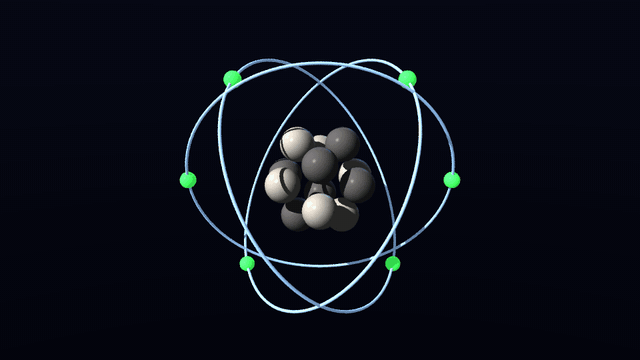

`samples/knight` holds another movie made in AVA Modeler: a chess knight on a table, turning, 12 seconds at 30 frames
a second, as [`knight.mp4`](samples/knight/knight.mp4) and the looping GIF below.

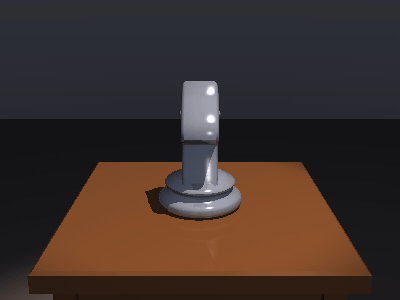

### Recipes (MCP prompts)

The server also offers saved recipes as MCP prompts (in Claude Code, `/` lists them as
`/mcp__avamodeler__lathed_vase` and so on): short step-by-step plans, each step with its exact tool call, that take
arguments such as a size, a colour or a frame count. The tests follow every one, call by call, so they stay correct.

| Prompt | What it makes |
|---|---|
| `lathed_vase` | A vase: a profile drawn with `add_points` and `add_polygons`, lathed round Y. |
| `table` | A table: a lathed leg cloned to the four corners, under a box top. |
| `chess_pawn` | A chess pawn, lathed from one profile. |
| `three_point_lighting` | Key, fill and rim lights aimed at an item. |
| `turntable_render` | The object on a null turning 360° over N frames, a camera, three-point lighting, and `render_animation` with a movie. |
| `bouncing_ball` | A ball bouncing on a floor, with squash and stretch through its scale keys. |
| `carbon_atom` | The carbon atom of `samples/mcp/carbon_atom.py`. |
| `morph_smile` | A smiley badge whose mouth smiles, through a morph keyed on `morph.Smile`. |
| `wave_flag` | A flag waving on its pole, through a travelling wave displacement with a keyed amplitude. |
| `printable_part` | A block with a hole bored through it by a boolean, checked with `check_mesh` (closed, printable, the volume it should have) and saved as STL. |
| `rounded_box` | A box with every edge rounded by Chamfer and a panel sunk into its top by Inset, checked with `check_mesh`. |
| `marble_table` | A table with a marble top and wooden legs on a checkerboard floor with a faint fractal-noise bump, all textured with `set_procedural` (no images), and rendered. |
| `product_shot` | A glossy ball on a floor as a product shot: an environment (an HDR file or a built-in one) lighting it and seen in its reflections, ambient occlusion, a big area light's soft shadow, and depth of field focused on it with `focus_on`. |
| `car_on_loop` | A toy car driving once round an oval loop through six nulls, facing along the road (`set_follow_path` closed with Align to Path and an even speed), seen from above with its path drawn, and rendered. |
| `reaching_arm` | A two-bone arm whose hand follows a keyed, moving ball by full-time IK (the ball is the goal, the elbow's heading limited), checked with `get_scene`'s `tip_to_goal`. |

## Building and testing

```bash
dotnet build AVAModeler.slnx
dotnet run --project src/AVAModeler
dotnet test AVAModeler.slnx
```

It needs the .NET 10 SDK. 951 tests cover every layer:

| Tests | Count | What they cover |
|---|---|---|
| Core | 73 | Math, the mesh and its edge maps, layers, selection modes, undo and grouped edits; UV maps through edits and undo, every projection's maths, image sampling and tiling, PNG and BMP reading, finding images; the noise (its table a permutation, reference values fixed for good, its range and mean), and each procedural at known points or by its statistics: the checkerboard alternating (a floor on a cube's side not speckling), grid lines at their spacing and thickness, dots' size and fuzziness, fractal noise from 0 to 1 with a mean of a half and contrast spreading it, marble's veins along the axis and wood's rings round it, ripples in circles, falloff, settings by name and their limits, and changing a layer's type; the Radiance HDR reader on hand-built files (flat pixels and their shared exponent, new-style run-length scanlines with runs and literals, the old repeat encoding, bottom-up pictures, exposure, what it refuses) and its writer; backdrops: each flat view's axes, an image's size from its shape or a height, its world corners and where world points fall in it, fitting round a box with a margin, sizing from pixels, settings refused out of range, a document keeping them unmodified and in copies, the picture inverted, contrasted and brightened (made once), a missing image's note, setup files round-tripped with relative images (and moved), and the per-object memory (relative images, forgetting, a damaged file, its capacity) in temporary folders |
| Formats | 93 | LWOB byte-identical round trips (textures included, and hand-built procedural CTEX/BTEX/DTEX/STEX sub-chunk sets: their colours, values, falloff and settings read, an unknown kind kept, edits rewriting only what changed, new procedurals of every kind written and read back), LWLO layers, detail polygons, LWO2 (UV maps, seams and image blocks), GEO, OBJ (`vt` and .mtl maps), image paths, malformed files; glTF: a .glb's structure checked by hand (header, 4-byte chunk alignment, the JSON, POSITION's min and max, buffer views inside the buffer), round trips as .glb, .gltf and .gltf with a .bin (triangle counts, positions, UVs, materials and the embedded image), a known triangle facing the right way after conversion, smooth and flat normals, projected maps baked into UVs, node transforms, strips and outside files, malformed files; STL binary and ASCII round trips, Z up and winding, a binary file that starts with "solid"; LWO2 procedural blocks (known kinds read, others skipped); colour procedurals baked into glTF images, as a box map (each side's checks where they are on a box and a floor) and through a UV map |
| Geometry | 110 | Booleans and drills (exact volumes, watertight results, UVs kept), subdivision, the Multiply algorithms, triangulation; the mesh check on known shapes (a closed box's volume, area and centre, a missing face's 4-edge hole, two holes, two shells, a flipped face, an inside-out box with negative volume, a cavity, duplicate and unused points, degenerate and non-manifold polygons, a ball's volume against 4/3·π·r³, non-planar quads, dots and lines, millimetre sizes) and Remove Degenerate; the edge and face tools, each followed by the mesh check: loops across a grid, round a hole's rim and stopped by a triangle, rings round a cylinder and a box, Loop Cut round a box (one cut and three) and a cylinder and across one into its caps, Fill Hole every way on a box missing a face and as quads on an octagon, Bridge between two open boxes (at every starting rotation, without twist, and in segments), between two faces and between edge loops, refusing 4 points against 8, Inset one face (with a frustum's exact volume) and as a group or face by face, Chamfer of one box edge (the prism's volume), rounded (against a quarter circle), three edges at a corner, every edge and a loop of four; UVs on the new points checked against their positions |
| Rendering | 44 | The four views' projections; a document as the views draw it; the OpenGL camera matrix landing every point where the software one does; shading, smoothing, picking; textures, with the OpenGL renderer's textured picture checked against the software one (on a real OpenGL or OpenGL ES context where there is one); a checkerboard drawn at every pixel of a four-cornered face, value-channel and unknown procedurals leaving the view alone, and marble, fractal noise, wood, dots and a checkerboard drawn by the OpenGL shader as the software renderer draws them (its vertex data and sums, and on a real context); backdrops in the top, front and side views where their world coordinates say (each view's camera axes matching), panning and zooming with the view, not in the other views, under the grid and the wireframe, brightness, contrast, invert and opacity, a missing image's checker, and the OpenGL renderer's backdrop matching the software one (its vertex data and shader sums, and on a real context) |
| Tools | 85 | Every tool, the numeric parameters and their checks, the command API, Lua macros (and their time limit), a plugin loaded from its own assembly, the spaceship and logo built from scratch; Make UVs, UVs through every kind of edit, the UV space, the texture commands, macros saving and loading glTF and STL; Select Problems for each kind (and its undo), Align fixing what the check calls flipped, Remove Degenerate (and its undo), and `checkmesh()`; Select Loop and Ring (from an edge or two points), and Loop Cut, Inset (group and individual), Chamfer, Fill Hole and Bridge on UV-mapped boxes: closed, mapped, undone exactly and redone, their errors, and a macro using `seledges`, `selloop`, `selring` and the new tools; `proctex()` and `texture()` with a procedural's name (settings by name, each call one undo step, mistakes changing nothing) and the procedurals sample; `backdrop()` and `nobackdrop()` (options, relative paths from the macro's folder, Fit and PixelSize, mistakes changing nothing, a missing image's note, backdrops kept through new and load) and the rocket blueprints sample |
| Scene | 200 | Transforms, TCB envelopes, cameras, lights, LWS v1/v3 and JSON scenes, bones, morphs, the ray tracer and its textures, filtering and bump maps; procedurals rendered (a marble ball differing from a plain one and the same every time, a checkerboard moving with its object or staying put in world coordinates, a luminosity procedural, fractal-noise and ripple bumps changing the shading but not the silhouette) and kept in .avascene files; scene snapshots (morph and displacement settings included) and copies, aiming an item at a point, object paths relative to the scene; the render effects: with all of them off a busy scene renders byte for byte as before they existed (pinned hashes), ambient occlusion darkening a corner but not the open floor, an area light's shadow with a penumbra where a point light's is hard (and a radius softening point and spot lights), an area light shining from its front only, the environment as the backdrop in every direction (turned by its heading, scaled by its intensity), in a mirror, and lighting a ball's side facing the bright sky, built-in environments and a missing one's warning, depth of field keeping the focused card's edge sharp and blurring the other, LightWave's lens maths, motion blur smearing a moving ball along its path while a still one stays sharp (and a panning camera), the same picture every time on any threads, and every setting through snapshots, copies, .avascene (an environment file stored relatively) and .lws (LightWave 5's and 6's camera lines and area lights); inverse kinematics: a two-bone arm reaching a goal within reach (and following it as it moves), stretched straight toward one out of reach, joint limits keeping rotations in bounds, locked channels keeping their keys, an anchor stopping the chain, the same answer every time, in copies and on many threads, the solved pose bending the object, full-time IK off playing the keys, baking, what can't be a goal, and the settings through snapshots, .avascene and .lws (LightWave 5's `GoalObject` and limits read); following a path: the spline along a line and round a circle (on it, wrapping, evenly by length, turning by one over its radius), an item where its path.position says at each frame, aligned along the tangent and looking ahead, banking into turns with its bank key added, a parented follower and moving points, what can't be a point, points removed, snapshots, copies, .avascene, the .lws warning, and baking; an item's lock through copies, snapshots and .avascene (written only when set) |
| Layout | 59 | Layout's session without its controls: how values become keys (the controls' and agents' alike), the modified flag, loading and saving scenes, looking through a camera, what the views draw (a colour procedural moving with its object); undo and redo of every kind of step, a drag as one step, the depth limit, clearing on a new or loaded scene, undoing back to the saved scene; rendering animations (numbering and step, progress, cancelling, the scene copy) and joining them into movies with ffmpeg (its arguments, finding it, doing without it, and a real MP4 and GIF where it's installed); glTF scene export (the hierarchy, a camera and lights, a heading turning the same way, keyed motion sampled every frame, a .gltf with its .bin, and what it leaves out, an area light as a wide spot); the render effects' undo, Focus on (an object's middle, a null, refusing one behind the camera), the area light's and soft light's drawings, a missing environment among the image problems, and Render Animation with motion blur; a banked camera's view tilting a horizon as the ray-traced render does (and its axes where the render has them); IK's Bake and Key IK as undo steps and the goal's line in the view; the dope sheet's rows, choosing keys by click, Shift and box, moving them snapped to frames as one undo step keeping their TCB, replacing keys they land on, scaling about the earliest or a pivot (keys merging), copying and pasting at a frame, deleting all but a channel's last key, and lights' and morphs' channels; path following's Even speed, path.position keyed by the usual rule and in the dope sheet, baking, and the path drawn in the view |
| Mcp | 118 | Every MCP tool group with its errors and undo, the Layout tools included (unknown items and channels, frames out of range, paths outside the working folder, a failed call leaving the scene as it was and no undo step, undo_scene and redo_scene on the shared history, the look-at maths, keys read between frames); morphs (targets copied, mismatches refused, weights keyed), displacements (the wave's maths, renumbering), skelegons → bones and bones' rest settings, each undone; render_animation's movies (with ffmpeg, and without it) and make_movie joining frames rendered in parts (missing frames, mixed sizes); every recipe (prompt) followed call by call through the server and its result checked; whole agent sessions building a table and then staging, animating, rendering, saving and reopening a scene; the live mode through a pipe and the bridge, its UI-thread marshalling, the person's undo taking back an agent's scene step, and its waiting for a busy person; the built app as an MCP server and as a bridge, as real processes; saving and opening .glb, .gltf (with and without a .bin) and .stl (binary and ASCII) through the handlers, a macro and a client, never over someone else's .bin, and export_scene; check_mesh (volumes in m³, inside-out and open meshes with their fixes, layers from 1, bad arguments) and an agent checking, selecting, fixing and checking again through a client; `select_edges`, `select_loop` and `select_ring` (and their mistakes), Loop Cut through `run_tool` as one undo step, and an agent bridging two boxes, rounding every edge and filling a hole through a client, checking each time; `set_procedural` (settings by name, the same layer or a new one, values and amplitudes, its mistakes changing nothing, its description naming every kind and setting with its default) and an agent texturing a floor through a client, seen in render_view and render; the marble table recipe; the render effects through set_scene (one undo step, built-in and file environments), add_light and set_item (area lights, radii, depth of field with focus_on, f-stop or aperture, motion blur), their mistakes changing nothing, render_scene and render_animation honouring them (the rays a pixel counted against the limit), a client reaching them, and the product shot recipe; set_backdrop (placing, changing, fitting, sizing from pixels and clearing, no undo step, paths outside the working folder and files that aren't pictures refused, mistakes changing nothing), render_view showing and framing a backdrop, get_document listing them, and an agent using them through a client; render_scene_view's camera view turning with the camera's bank; set_ik (goals, limits, locks, anchors, full time, its mistakes changing nothing, undo) and bake_ik, directly and through a client; shift_keys and scale_keys (one item or all, one channel, a range, replacing keys, their mistakes); set_follow_path (a closed loop timed by from_frame and to_frame, facing along it, path.position through get_keys and set_key, its mistakes) and bake_path; and the reaching_arm and car_on_loop recipes; set_item's lock (shown only when set, undone); server profiles: every tool in the scene or the modeling group, AVA Modeler's own profile unchanged, and another app's Layout-only server (its tools, recipes, descriptions, instructions and version, add_object asking for a file, its own live pipe and bridge, and its command line) |
| Hub | 8 | The hub's wire on pipes of the tests' own: a message answered, a refusal and a handler's failure coming back as their reasons, bad messages refused before the app sees them, one listener a pipe (and starting again after stopping), an app that isn't there said quickly, per-app per-user pipe names, the owner-only hand-over folder and its file names, and finding the other program (a setting, beside this one, a sibling folder, the PATH, a development .dll run with dotnet) and its command line, never started for real |
| Chat | 57 | The chat's agent loop against a fake Anthropic API (no real calls): a conversation that makes a ball, looks at it and answers, with the picture going back as an image block; the tools sent being exactly the MCP server's; prompt-cache breakpoints; tool errors, 401, 429, 529, 500 and network failures with Retry; the step cap, and Auto-continue carrying on past it by itself, then stopping at its ceiling; Stop while a reply streams and while a call waits for a busy person; New Chat in the middle of a request; the API key's file (owner-only) and masking. The same against a fake OpenAI-compatible server (no real server): streamed text, tool calls whose names and arguments arrive in pieces put together and run, several calls in one turn, the request's tools, tool messages and image parts checked as JSON, pictures as a note for a model that can't see them, the core tool set, 401, 404 (model not found), 400 (no tool support, no images), 429, 500 and a refused connection as one line with Retry, a gateway's key only in its header and masked even when echoed back, Stop mid-reply, the tool limit and Auto-continue, arguments that aren't JSON, an answer that isn't streamed, a reply cut short, a missing model or bad base URL, switching provider, model lists in OpenAI's and Ollama's shapes, and the gateway key's own owner-only file; chat history in a temporary folder: a Claude chat saved, opened in a new session and carried on with the same tool_use ids, results and picture in Anthropic's format, and an OpenAI-compatible one in its own (tool_calls and tool messages); another provider's chat read-only until that provider is chosen again; no key (Anthropic's or a gateway's) in any file, and owner-only files; pictures over the limit left out and said to be; newest first, delete, clear, damaged files and bad ids; Markdown export with pictures beside it; a chat saved mid-request carrying on with its calls answered; another app's own system prompt and core tools for both providers, its profile's tools, and its name in exported chats |
| UI | 104 | The window, mouse and keyboard driven through a headless window, the numeric panel folding (N) and a requester opening it, the chat's Auto-continue box, the UV view, the texture panel (its Texture type list turning a layer into a procedural and back, the procedural's settings shown, one undo step, an unknown kind shown as not drawn), Layout (its Ctrl+Z, Ctrl+Shift+Z and Ctrl+Y, and Edit › Undo and Redo) and its Render Animation window, an AI agent working in the open window and in its Layout scene, the AI Chat panel (a fake Claude making a ball that Ctrl+Z undoes, a missing key, Retry, Stop while the person is busy; switching to a fake local server in Setup…, Refresh listing its models, building with it and switching back; Preferences reaching the panel; a server that isn't running), the chat settings' preferences round trip, Mesh Info (W, following the object, its Select button and Ctrl+Z, its Align button sparing a cavity, the menu and tabs), the new tools' buttons, keys (Alt+L, Alt+R, I, Ctrl+B) and menu items, a Loop Cut dragged with no edge saying why and changing nothing, Mesh Info's Fill Hole button, and the screenshots (one of the still life opened again from a .glb, one of Mesh Info, one of the edge tools, one of the chat on a local model, the procedurals in the view, the texture panel and a ray-traced frame); Scene Settings' ambient occlusion and environment (one undo step, bad values and a missing picture refused), the camera panel's depth of field, Focus on and motion blur, the light panel's area size, radius and shadow samples, and the render effects' screenshots (the showcase, a motion-blurred frame and the settings panel); the Backdrop panel (D, the Display tab, typed numbers changing the view at once, the height and Keep shape, Fit to Object, Size from Pixels, a missing image's note, Clear), Save and Load Setup, backdrops kept through New, remembered for an object's file (in a temporary folder) and back when it's opened, a missing one's checker and note, and the blueprints screenshot; the IK settings in the bone panel (goal choices, limits typed in, locks, anchor, Bake IK and Ctrl+Z); the dope sheet (D and View › Dope Sheet, click, Shift-click, dragging keys in time, a box, arrows, Delete, Ctrl+C and Ctrl+V, Ctrl+A and Scale ×, scrubbing the frames); the item panel's path (points chosen, Follow a path, Closed, Even speed, Bake path, undo); chat history (off by default, Keep chat history saving at once and after each request, History's list, opening, exporting, deleting and clearing, the last chat back in a new window, another provider's read-only and back); and the screenshots of the dope sheet with a car on its path, an IK arm through a banked camera, and the chat history; Layout's view for other hosts (the mouse modes, the axes, the edit-mode pick filter, locked items left alone, the light view) and the item panel's extras; the chat panel's wording for another app; and the hub in a window on pipes of the tests' own (Edit in Modeler opening an object and linking it, refused over unsaved work, a save telling AVALightWave with the link, Send to AVALightWave handing over an unsaved object as a copy and keeping its link, and starting AVALightWave, faked, when it isn't there) |

The screenshots are drawn by the tests in a real (headless) window:

```bash
AVAMODELER_SHOTS=$PWD/Images dotnet test tests/AVAModeler.UI.Tests --filter Screenshot
```

## How it's built

Core, Geometry and Tools carry no UI, so tools are tested without a window, scripts and AI agents drive them, and
Layout reuses them.

| Project | What's in it |
|---|---|
| `AVAModeler.Core` | Double-precision math, the mesh (indexed points and n-gon polygons, with lazy edge and adjacency maps, and UV maps), layers, surfaces and their texture layers, the projections, the procedural textures and their noise, texture images (PNG and BMP read here) and Radiance HDR pictures, selection, undo (copy-on-write snapshots of the layers an edit changes), the document, the backdrops' settings, placing maths and setup files, PNG writing |
| `AVAModeler.Formats` | LWOB/LWLO read and write, LWO2 read, VideoScape GEO, OBJ, glTF 2.0 (written by hand with System.Text.Json, colour procedurals baked into images) and STL |
| `AVAModeler.Geometry` | Triangulation (LibTessDotNet), BSP booleans and drills, Catmull–Clark subdivision, the extrude/lathe/bevel family, the mesh check (Mesh Info and `check_mesh`) |
| `AVAModeler.Tools` | The tool framework and every tool, Make UVs and UV space, the command API, Lua macros (MoonSharp), plugins, SkiaSharp image reading |
| `AVAModeler.Rendering` | `IRenderer`, the software and OpenGL renderers and their shared texturing (backdrops included), the view cameras, picking |
| `AVAModeler.Scene` | Layout: the scene graph, envelopes, cameras, lights, bones and their inverse kinematics, path following, LWS and JSON scenes, the ray tracer and its render effects (ambient occlusion, soft and area lights, environment pictures, depth of field, motion blur) |
| `AVAModeler.Layout` | Layout's state without its controls (the scene being worked on, its frame and chosen item, its undo history, scene files and glTF scene export, what the views draw, the dope sheet and moving keys in time, rendering animations and joining them into movies with ffmpeg), shared by the Layout workspace and the MCP server |
| `AVAModeler.Modeler.UI` | The Modeler workspace: the quad view, tool tabs, numeric panel, Mesh Info and Backdrop panels, layers, surface editor, preferences |
| `AVAModeler.Layout.UI` | The Layout workspace: the scene view, items (with IK and path settings), timeline, graph editor, dope sheet, render and animation windows |
| `AVAModeler.Mcp` | The MCP server for AI agents: the Modeler and Layout tool handlers (shared by both modes), the headless host, the live host and its local-pipe listener, the `--attach` bridge, and server profiles (another app serving a chosen set of the tools) |
| `AVAModeler.Chat` | The AI Chat's conversation and agent loop, with two providers: Claude on the Anthropic C# SDK (streaming, prompt caching), and any OpenAI-compatible Chat Completions server (HttpClient and System.Text.Json, streamed tool calls); the bridge to the MCP server's tools through an in-process MCP client, the API keys' stores, and saved chats (history and Markdown export). No UI |
| `AVAModeler.Chat.UI` | The AI Chat panel's controls, shared with [AVALightWave](https://github.com/Harlock123/AVALightWave) |
| `AVAModeler.Hub` | The hub: the live link with AVALightWave over a per-user local pipe (messages, listener, client, hand-over folder, finding the other program) |
| `AVAModeler` | The application: one window hosting both workspaces, the AI Chat panel, and its end of the hub |

## Known limits

- **The OpenGL renderer** is off by default. The software renderer draws the same picture and is fast enough for
  models of tens of thousands of polygons. The OpenGL path's camera is tested against the software one point for
  point, but it hasn't been tried on every GPU and driver; if a context can't be had, the views fall back to software.
  Layout's view is drawn in software.
- **Booleans** use floating-point BSP: reliable on everyday shapes, but faces that are nearly (not exactly) coplanar
  can leave slivers. Both solids should be closed and face outward. Coplanar pieces of different faces stay separate
  (Merge Polygons tidies them).
- **Byte-identical LWOB round trips** are tested on hand-built files covering every chunk type. Files with more than
  one SRFS chunk, or a repeated PNTS/POLS in a layer, read correctly but are rewritten in the standard order.
- **Bevel** works per face, as LightWave 5's did; Inset's Group mode (with a Depth) is the group bevel.
- **The edge and face tools**:
  - Loops and rings follow quads only: a loop stops at any point that isn't four quads round it (a pole, a triangle,
    an n-gon), a ring at anything that isn't a quad. Loop Cut's Position places a single cut; several are always
    evenly spaced. A cut at 0 or 1 is kept a hair inside the edge.
  - Bridge needs the same number of points on both sides (it doesn't resample) and joins edges with a face on one side
    only (rims) or none (lines); bridging loops that cross makes a twisted band.
  - Chamfer works on edges with a face on each side. Width isn't checked against the faces: one wider than a face
    makes overlapping geometry. A corner where three or more chamfered edges meet is closed with one flat polygon
    (with Segments above 1, an n-gon round the curved strips' ends, not a rounded corner patch), as is the small gap
    where a chamfer ends at a point with four or more edges. Slides along an edge are limited to most of it (half of
    it when both ends slide).
  - Inset's Thickness isn't limited either: too much folds the inset face over. In Group mode a point the region
    shares with other faces only at a corner (not along an edge) stays put. The strip and corner polygons of a rounded
    chamfer, and Bridge's band, take UVs interpolated between their sides rather than laid out afresh.
- **Textures**: the views show colour layers (up to four a surface, images and procedurals together); the other
  channels and bump maps show in the ray tracer. Cylindrical and spherical maps are worked out per corner in the views
  (and exactly per pixel in the ray tracer), so a big face can differ slightly. Procedurals are worked out at every
  pixel, which makes a view with many of them on screen slower to draw; the OpenGL renderer does it in single
  precision, so the edges of checks and dots can fall a pixel differently from the software renderer's. LightWave 5's
  Brick, Veins, Crust, Smoky and other procedurals this doesn't draw are kept from LWOB files and written back but not
  drawn. Grid, Dots, Bump Array and Wood's rings are seen down the texture axis (straight through along it), rather
  than as LightWave's fully 3D lattice; Ripples' and Underwater's wave speed is kept but the waves don't move; and the
  patterns are this program's own sums on Perlin noise, so they look like LightWave's rather than match them pixel
  for pixel. LWO2's procedurals come in at their kind's default settings (each LWO2 kind keeps its own in a layout of
  its own, which isn't read), and its gradient, unknown procedural and front-projection layers are skipped. LWOB has
  nowhere for a layer's blending mode, so it isn't saved there (the native .avascene keeps it). Tools that make new geometry from nothing (Box, Text and so on)
  leave it without UVs, and a swept wall takes its edge's UVs at both ends rather than new ones.

- **glTF and STL** are for exchange, not for keeping work: save as .lwo to keep everything. Writing glTF leaves out
  points, 2-point lines and detail polygons, every texture but each surface's first colour image or its baked colour
  procedurals (no specular, bump, luminosity or transparency maps, procedurals on other channels, or blending modes;
  a box-map bake is exact for faces lying on the surface's bounding box, a floor or a box, and an approximation on
  curved ones; a layer in world coordinates is baked in the object's), and LightWave's specular level beyond
  roughness; images that aren't PNG or JPEG are re-encoded as PNG. Reading glTF takes meshes and base colour textures
  only: no normal, metallic-roughness, occlusion or emissive maps, extra UV sets, vertex colours, points or lines,
  skins, morph targets, animations, cameras or lights, sparse accessors or Draco and other compression extensions;
  KHR_texture_transform is ignored. An image inside a .glb or .gltf is kept in memory under a made-up path beside the
  file, so saving the object as .lwo afterwards refers to an image that isn't on disk: save the picture out (or
  re-export as .glb) to keep it. glTF has no smoothing angle: a surface read back is smooth or flat as its normals
  show, at the usual 89.5°. STL keeps nothing but triangles (no surfaces, layers or UVs); the colour bits some
  binary STL writers use aren't read. The Scene export writes each object's undeformed mesh (no bones, morphs or
  displacements), the first frame's zoom and light intensity, hidden items as ordinary nodes, light intensity as
  LightWave's 100% = 1 (not in physical units), and motion sampled linearly every frame, not as TCB curves. glTF has
  no shear, so a non-uniform scale under a turned parent comes out slightly different. There's no Khronos validator
  in the tests; the files are checked structurally (header, chunk alignment, accessor bounds, buffer views).

- **Mesh Info and `check_mesh`** check the whole foreground layers (not the selection), each layer on its own. They
  don't find faces that cross each other (self-intersections) or walls too thin to print. An inward shell counts as
  a cavity when its bounding box lies inside another closed shell's, which is a quick test rather than a proof. Align run on
  everything turns cavities outward too; Mesh Info's Align button leaves them out. A face that uses one
  point twice is reported as degenerate and left out of the edge counts. The Fix buttons clear the selection first,
  so the tool acts on everything in the foreground. Fill Hole closes holes with flat polygons (or triangles); a rim that
  lies on top of another is duplicate points, for Merge Points, not a hole to fill.

- **Backdrops** are behind the Top, Front and Side views only: the perspective view (and Layout) shows none, as a
  picture fixed to the screen wouldn't line up with anything there. One image per view. The grid is drawn over them at
  full strength. Pictures are sampled bilinearly without mipmaps, so a large blueprint shown much smaller than its
  pixels can look a little rough (draw blueprints with lines a few pixels wide). Size from Pixels takes a size per pixel
  rather than reading DPI from the file. Backdrops are kept in no object or scene file (not .lwo, .avascene or .lws):
  they're remembered per object by its full path, so a moved or renamed object file comes back without them unless
  its setup was saved with Save Setup (or the object is saved again). Changing them isn't an undo step, for agents
  either; agents' backdrop images must be in the working folder.

- **Render Animation** needs ffmpeg on the PATH for MP4 and GIF (it isn't bundled); without it, the PNG frames are
  still written. Frames are numbered from 1 in the order rendered, not by scene frame. It renders frames one after
  another (each one multithreaded), with motion blur when the camera has it, and no field rendering.
- **The render effects** are sampled, so too few samples look grainy: raise them (and the render time) rather than
  expecting the picture to clear by itself. Ambient occlusion dims only the ambient light (as LightWave's later
  ambient occlusion did), so with ambient at 0 it does nothing; every surface it meets hides light, transparent ones
  too. The environment's lighting gathers from a 64 × 32 blurred copy of the picture, so it's soft: a small, very
  bright sun in an HDR lights like a bigger, dimmer patch and casts soft shadows (add a distant light for a crisp sun
  shadow); it lights diffusely, and only reflections (not highlights) show the environment's detail. Motion blur
  works the scene out at up to 32 moments across the shutter, rather than per ray, and the lens's zoom is taken at the
  frame, not across the shutter; depth of field focuses on a flat plane at the focal distance. Area lights shine from
  their front only and aren't seen by the camera or in reflections, and distant lights stay hard-edged. In `.lws`
  files an area light is written as LightWave 6's (light type 4) and a camera's depth of field and motion blur as
  LightWave's own `DepthOfField`, `FocalDistance`, `LensFStop`, `MotionBlur` and `BlurLength`; an area light's size,
  a light's radius, the effects' sample counts, ambient occlusion and the environment have no place there and are
  kept only in `.avascene`. glTF export leaves them all out.

- **Following a path**: the path runs through items (nulls, usually), in the order given (in the panel, the item
  list's order); a Modeler layer's lines or another item's motion path can't be used as a path. Bones can't follow
  paths. Align to Path sets heading and pitch from the curve, so an item looking straight up or down along it can
  spin about the vertical; banking is worked out from how fast the curve turns seen from above, over a stretch of it,
  so it eases rather than following every wobble, and a spline through few points turns a little faster near its
  points than between them. While an item follows a path its position keys (and, aligned, its heading and pitch keys)
  are kept but not used. LightWave scenes have no place for path following: `.lws` gets the item's own keys and a
  warning (bake the path first); `.avascene` keeps it, and glTF export writes the motion it makes.
- **An item's lock** (`set_item` `locked`, and a scene editor's lock) only keeps the mouse off it in the views: it isn't
  picked or dragged there, but its numbers, keys and agents still change it. `.avascene` keeps it; `.lws` and glTF have no
  place for it.
- **The dope sheet** always fits the scene's frames across its width (there's no zooming in on a stretch of frames),
  and shows only keys inside them; channels never keyed (holding a constant) have no row or keys. Keys move by whole
  frames only. Scaling that brings keys of one channel onto the same frame keeps the later one. Copied keys paste onto
  the same items' channels (not onto another item), and the clipboard is the dope sheet's own, not the system's.
- **Inverse kinematics** is for bones: objects, nulls, lights and cameras have no goals (LightWave's IK on any item,
  goal strength and matching the goal's orientation aren't there). A chain has one goal, on its end bone; where two
  chains share bones, the first in the scene turns them. The solver starts each frame from the keyed pose, so which
  way an elbow bends comes from the keys (or rest pose): limit or lock a channel to keep it bending the right way.
  Limits are applied to heading, pitch and bank as numbers, so close to a pitch of ±90° (where heading and bank turn
  about the same axis) they can behave unexpectedly. In `.lws` files a bone's goal is written as `GoalItem` (LightWave
  5's `GoalObject` is read too), with `FullTimeIK` and `HLimits`, `PLimits` and `BLimits`; the anchor and locked
  channels have no place there and are kept only in `.avascene`. glTF export writes the bones' solved motion only as
  it moves the items exported (bones themselves aren't exported); bake the IK first for programs that need keys.
- **Layout's undo** covers the scene only: not the object's geometry (that's the Modeler's undo), the current frame or
  which item is chosen. A morph target's mesh is kept by reference, so to be undoable it is replaced rather than
  edited in place. The depth is a fixed 100 steps (the Undo Levels preference is the Modeler's).
- **AI agents (MCP)**: Points and Drag work only with the mouse, so agents use `add_points` and Move instead.
  `undo_scene` can't go back across `new_scene` or `open_scene`, which clear the scene's history.
  `render_animation` does at most 120 frames and 20 million rays a call, so the agent renders a long animation in
  parts and joins them with `make_movie` (Layout's Render Animation window has no such limit). `render` uses a fixed camera rig and
  lights round the object. Only one AVA Modeler per user takes agents at a time. Inside `run_lua`, `undo()` and
  `redo()` aren't allowed (the macro is one undo step) and a macro stops after 30 seconds unless given longer. Texture
  image paths may point outside the working folder (they're only read). The live pipe is tested on Linux; Windows and
  macOS use the same .NET pipe code but haven't been tried.

- **AI Chat**: with Claude it needs your own Anthropic API key and internet access, and your API account pays for it. One
  request pauses every 60 tool calls; with Auto-continue ticked (beside the model, on unless you untick it) it
  carries on by itself, up to 600 calls in all, and without it you say "continue". Stop ends a request at any time. A
  conversation is kept only with Keep chat history ticked (off by default); one interrupted by the app closing
  mid-request opens with its unfinished calls marked as not run. Pictures over the size limits aren't kept, so a
  reopened chat's later requests don't send them. A conversation isn't trimmed: a very long chat grows slower and
  dearer, so start a New Chat for a new job; a chat can't move between providers (the other's opens read-only). The
  Markdown export is for reading, not for opening again. Claude's files go in
  your Documents folder (the chat's working folder). It's tested against a fake API only; the real API's behaviour
  (and its model names) can change.
- **AI Chat on a local or self-hosted model**: how well it works depends on the model. Small local models use tools
  far less reliably than Claude (wrong arguments, losing track, stopping early) and are best at simple jobs; give
  Ollama a long enough context (`OLLAMA_CONTEXT_LENGTH`), or the tool definitions crowd out the conversation. Pictures
  reach the model only if it's a vision model and the box is ticked; servers differ in what they accept (some take no
  images, or no tool calls while streaming). It's tested against a fake server only, built to the OpenAI Chat
  Completions format; real servers' quirks (Ollama, LM Studio, vLLM, llama.cpp) haven't all been tried. Changing
  provider starts a new chat. A model that writes its thinking into the reply as `<think>` text (qwen3 on older
  Ollama versions) shows that text in the chat; a separate reasoning field is ignored.

## About and licence

AVA Modeler © 2026 Lonnie Watson, under the [MIT License](LICENSE).

LightWave is a trademark of its current owner, LightWave Digital. AVA Modeler is an independent project inspired by
classic LightWave Modeler; it isn't affiliated with or endorsed by its owners. It reads and writes the classic object
and scene formats for compatibility. Lua support uses MoonSharp; polygon triangulation uses LibTessDotNet; the views
use Avalonia, SkiaSharp and Silk.NET.
