# AVA Modeler

[](https://github.com/Harlock123/AVAModeler/actions/workflows/build.yml)

A cross-platform recreation of the classic standalone 3D modeler of the mid-1990s, **inspired by classic LightWave
Modeler** (versions 4 and 5), built with .NET 10 and Avalonia. It keeps the classic workflow (the quad view, points
and n-gon polygons, foreground and background layers, tabbed tool panels, numeric requesters for everything, a
keyboard-driven, grid-snapped way of working) and adds modern touches: shaded and smooth-shaded views, multi-level
undo, edge selection, UV maps, and Lua macros. A **Layout** workspace in the same window animates and renders what you
model.

It follows the plan in [Classic 3D Modeler Recreation Plan.md](Classic%203D%20Modeler%20Recreation%20Plan.md), Modeler
phases 0 to 7 and Layout phases L1 to L6.

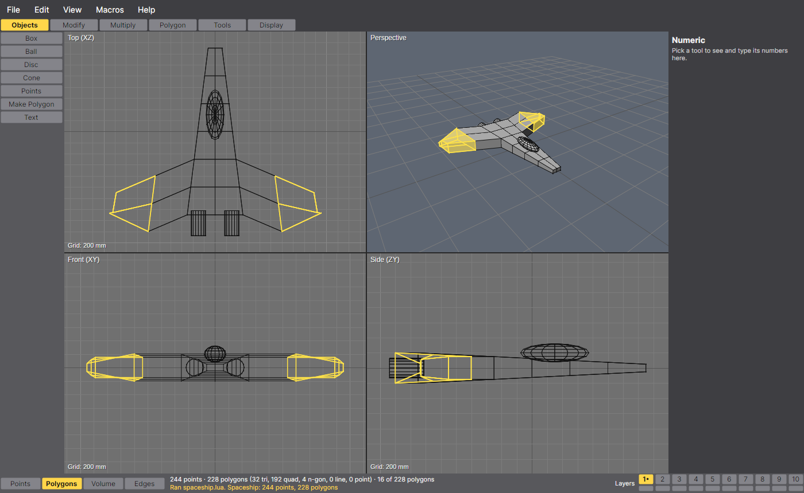

## Features

### The Modeler

- **The quad view**: Top, Front, Side and Perspective, laid out as classic Modeler had them. Double-click a view (or
  press 0) to fill the window with it. The flat views pan and zoom, with a grid that adapts to the zoom and shows its
  size; the perspective view turns, and is shaded with the wireframe on top. Fit all (A) and fit the selection
  (Shift+A).
- **Classic colours**: black wireframe on grey, background layers dimmed, selections in yellow. The modern touches
  are smooth and flat shading, faces seen from behind tinted blue so flipped polygons stand out, and anti-aliased
  lines.
- **Two renderers behind one interface**: a software rasterizer (the default, works everywhere) and OpenGL 3.3 /
  GLES 3 (in Preferences). Both draw the same picture.
- **The mesh**: points and polygons of any number of points, including 1-point polygons (dots) and 2-point polygons
  (lines). LightWave's left-handed space and clockwise winding are kept.
- **Ten layers**: each can be off, in the foreground (being edited) or in the background (shown, and the operand for
  booleans and drills). The buttons along the bottom set them: the top half for the foreground, the bottom half for
  the background, with Shift to add. The number keys do the same.
- **Selection**: Points, Polygons, Volume and Edges modes. Click to pick, drag a box or right-drag a lasso; Shift
  adds and Ctrl removes. You can also invert, select connected, grow and shrink. In Volume mode, drag a box in two
  views to build a 3D volume. As in the original, a tool given an empty selection works on everything. The status
  bar counts points and polygons by type, and selections survive undo.
- **Tools**: each tool has typed parameters, which feed both the numeric panel and dragging in a view, so the two
  stay in step. The preview is live while you drag; Enter keeps the result as one undo step, and Esc cancels. The
  action centre is the selection, the mouse or the origin, and grid snapping is available. Every key can be
  remapped.
- **The classic tabs**:
  - **Objects**: Box, Ball (globe or tessellated), Disc, Cone, Points, Make Polygon, and Text (font outlines, with
    the letters' holes cut in).
  - **Modify**: Move, Rotate, Size, Stretch, Shear, Bend, Twist, Taper, Magnet, Drag, Jitter, Smooth, Center and
    Quantize.
  - **Multiply**: Extrude, Lathe, Mirror, Clone, Array (rectangular and radial), Path Extrude, Rail Extrude, Bevel and
    Smooth Shift.
  - **Polygon**: Flip, Triple, Merge Points, Align, Unify, Subdivide (faceted or smooth), Metaform, Surface, Make UVs,
    Merge Polygons, Split and Remove.
  - **Tools**:
    - Boolean against the background layers: Union, Subtract, Intersect and Add.
    - Drill with the background's outline: Core, Tunnel, Stencil and Slice.
    - Cut, copy and paste between layers, and swapping the foreground and background.
- **MetaNURBS**: Tab shows the foreground as the smooth (Catmull–Clark) surface of its cage, with the cage drawn in
  blue. Metaform bakes the smoothing into the mesh.
- **Surfaces**: named polygon groups with colour, diffuse, specular, glossiness, luminosity, transparency,
  reflection, smoothing and smoothing angle. They are edited live in the surface editor, and smooth surfaces are
  smooth-shaded in the views.
- **Image textures**, the LightWave 5 way: a "T" button beside a surface's colour, diffuse, specular, luminosity,
  transparency, reflection or bump opens its texture panel.
  - Each layer has an image (PNG, JPEG, BMP and more), a projection (planar, cylindrical, spherical, cubic, or UV
    through a named UV map), an axis, a centre and size (with Automatic Sizing to fit the surface), tiling across and
    up (reset, repeat, mirror, edge), wrap amounts for cylindrical and spherical, and opacity and blending (normal,
    additive, multiply). Layers stack.
  - The perspective view shows colour textures, in both renderers; Layout's view shows them too, and the ray tracer
    uses every channel, bump included.
  - An image that can't be found or read shows as a magenta checker, and the status bar says which.
- **UV maps**: named per-point UVs, with per-polygon-corner UVs where a seam needs them (as LWO2's VMAP and VMAD).
  - **Make UVs** (Polygon tab) lays out the selection by a planar, cylindrical, spherical, cubic or atlas projection,
    into a new or existing map, cutting seams where a wrap needs them and leaving the neighbours' UVs as they were.
  - **The UV view**: U (or View › UV View) turns the view under the mouse into the current UV map, laid out over its
    texture. Points and polygons are picked there as anywhere, and Move, Rotate, Size and the other tools that move
    points move UVs (one undo step each). View › Next UV Map chooses another map.
  - UVs follow every edit: undo and redo, cut and paste, merging points, and mirror, clone, array, extrude, lathe,
    bevel, smooth shift, subdivide, metaform, triple, split and merge polygons carry or interpolate them. Booleans and
    drills give each cut face the UVs its source face had at the same place.
- **Files**:
  - LightWave objects: LWOB (and the LWLO layered form) read and written; an unchanged object writes back
    byte for byte. Surfaces' textures (CTEX, DTEX, STEX, RTEX, TTEX, LTEX, BTEX and their TFLG, TSIZ, TCTR, TIMG,
    TWRP, TFP0/1, TOPC, TAMP… sub-chunks) are read and written, keeping any sub-chunk this doesn't model. UV maps go
    in LWO2-style VMAP and VMAD chunks, which LightWave 5 skips.
  - LWO2 (LightWave 6 and later) is read only, with its UV maps (VMAP and VMAD) and image-map textures (BLOK and
    CLIP).
  - VideoScape GEO is read and written.
  - Wavefront OBJ is read and written, with its .mtl: texture coordinates (`vt`, faces as `v/vt`) and `map_Kd`,
    `map_Ks`, `map_Ke` and `bump` maps.
  - Image paths are stored relative to the object file where they can be, and looked for from it (and LightWave's
    Images folders beside it), then from the working folder.
  - Recent files, auto-save, and crash recovery: if the app didn't close cleanly, it offers the auto-save back.

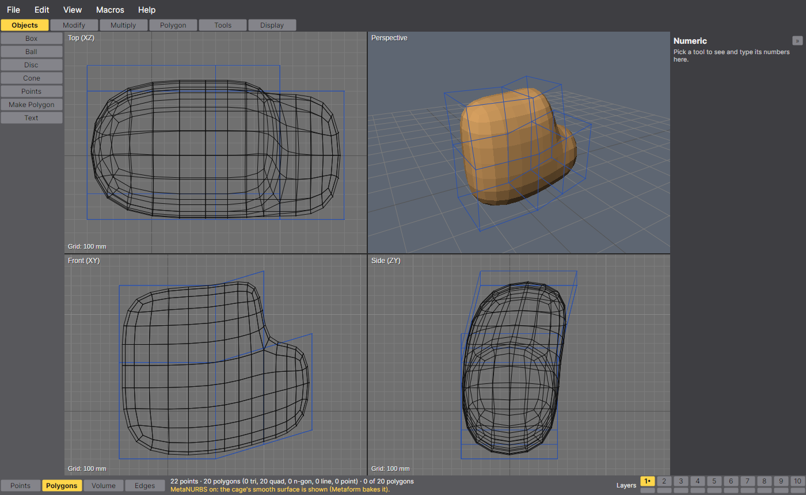

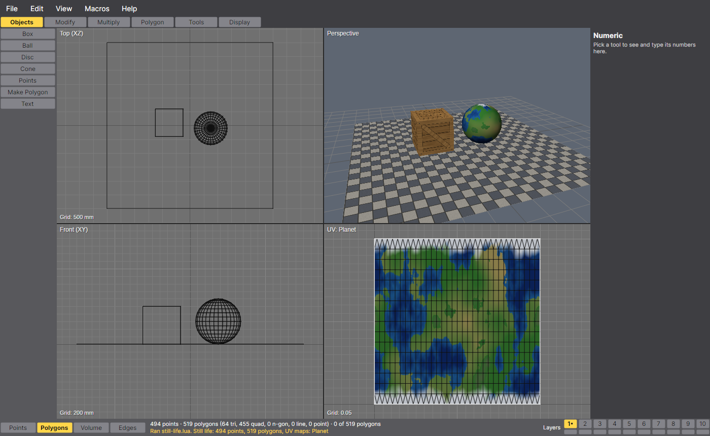

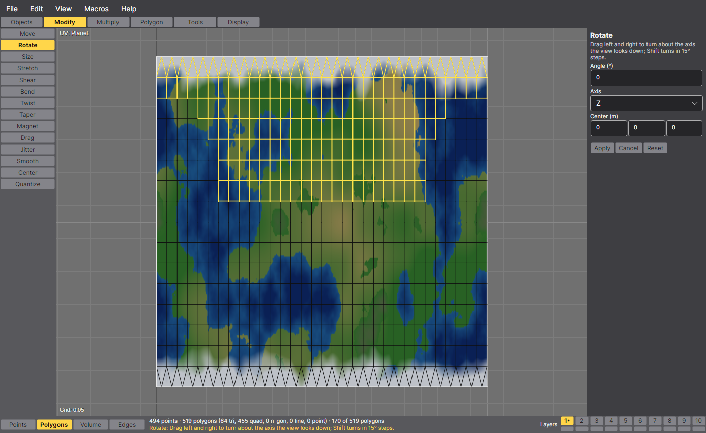

### Macros and plugins

- **Macros** are Lua scripts (through MoonSharp), in the spirit of classic Modeler's ARexx macros.
  - What they can do: run any tool with any parameters, build geometry point by point, select, set layers, undo,
    make and choose UV maps, texture surfaces, and load and save. Macros › Macro Reference lists every command.
  - Samples: `samples/scripts/spaceship.lua` models a classic spaceship from scratch, `logo.lua` makes bevelled
    flying-logo type, and `still-life.lua` builds a crate, a planet and a floor and textures them three ways (cubic,
    UV and planar), with the images in `samples/images` (drawn by `make_textures.py` there).
  ```lua
  tool("Box", { Size = {2, 1, 1}, SegmentsX = 4 })
  selmode("polygons"); selbox(-1, 0.4, -1, 1, 1, 1)
  tool("Extrude", { Offset = {0, 0.5, 0} })
  makeuvs("Wrap", "cylindrical", "y")
  texture("Default", "brick.png", { Projection = "uv", UVMap = "Wrap" })
  ```
- **Plugins** are .NET assemblies.
  - Any public `Tool` class in one becomes a tool in its tab. An `IModelerPlugin` class can also add file formats
    (loaders and savers).
  - Drop the .dll into the plugins folder (`~/.config/AVAModeler/plugins` on Linux, `%APPDATA%\AVAModeler\plugins` on
    Windows), or load one from Macros › Load Plugin.
  - `samples/StarPlugin` is a working example: a Star generator tool and a point-cloud (.xyz) format.

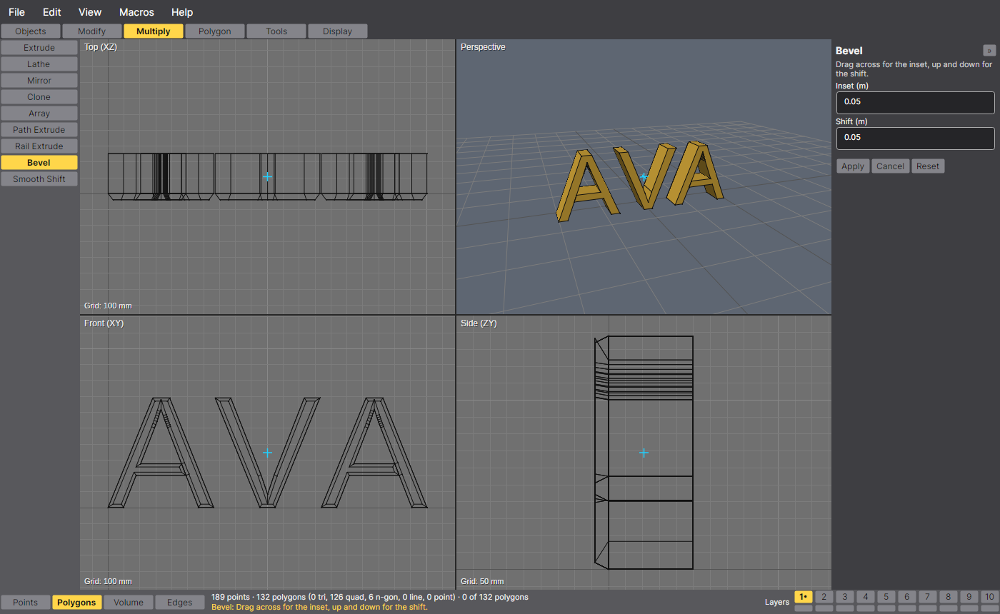

### AI agents

- **An MCP server**: AI agents such as Claude Code drive AVA Modeler through the Model Context Protocol, with the
  same tools and settings a person uses, each step one undo step. They model, and in Layout they stage, light,
  animate (morphs, displacements and bones from skelegons included) and ray-trace scenes, and render animations
  into MP4 and GIF movies. Saved recipes (MCP prompts) give them step-by-step plans to start from. `AVAModeler --mcp` works headless on a model and scene of its own; with Macros › Allow
  AI Agents on, an agent can also build in the open window while you watch. See
  [Driving AVA Modeler from an AI agent](#driving-ava-modeler-from-an-ai-agent).

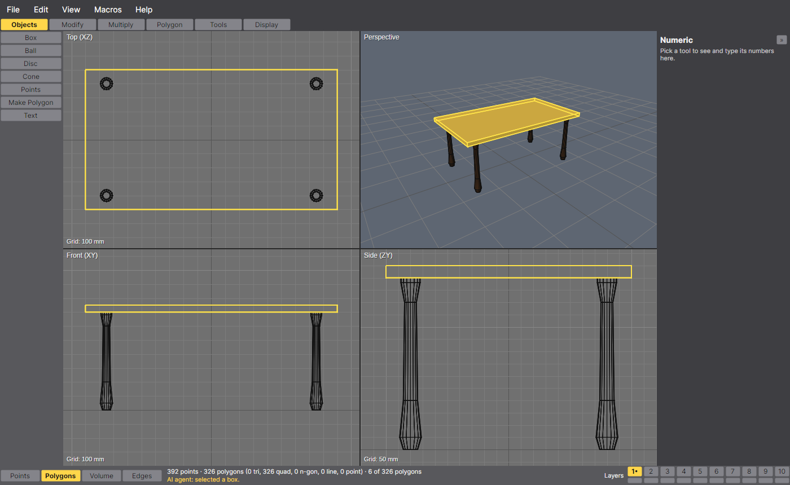

### Layout

Layout (F2, or View › Layout) is the second workspace. It shares the object you're modeling live: change it in the
Modeler and Layout shows the change at once.

- **The scene**: objects, nulls, lights, cameras and bones, each with a parent and a pivot. Objects can also be
  loaded from files.
- **Animation**: a key per channel, interpolated by Kochanek–Bartels TCB splines as classic LightWave did.
  - With Auto key on, moving or turning an item in the view keys it at the current frame. An item's first key
    replaces its starting value, so its motion begins at the first frame you key. AI agents' keys follow the same rule.
  - Delete Key leaves a channel's only key, which holds its value.
  - The timeline plays, steps, and shows the chosen item's keys.
  - The graph editor shows the channels as curves. Choose a key to set its value, tension, continuity, bias and
    linear flag, and set what happens before the first key and after the last.
- **Undo**: Ctrl+Z (Edit › Undo) takes back the last change to the scene, and Ctrl+Shift+Z or Ctrl+Y (Edit › Redo)
  does it again, up to 100 steps. The Edit menu names the step ("Undo Move Camera"). A drag in the view or the graph
  editor is one step, as are a value typed and entered, Create Key, Delete Key, adding or removing an item, Skelegons →
  Bones, parenting and the scene settings. AI agents' scene changes are steps on the same history ("Agent: added a
  light"), so your Ctrl+Z takes them back too. New Scene and Load Scene clear it. The object's geometry has the
  Modeler's own undo.
- **Cameras and lights**: the camera view with its picture shape and its action- and title-safe areas; zoom factor
  and field of view. Distant, point and spot lights have colour, intensity, cone, soft edge, range and shadows.
- **Scene files**: classic LightWave .lws scenes (LightWave 4 and 5, and later versions) are read and written, and
  there is a native .avascene format (JSON) that keeps everything, meshes included.
- **Rendering**: an offline CPU ray tracer, multithreaded and deterministic.
  - Shading: Phong with glossiness, luminosity, smoothing within each surface's angle, reflection, and transparency
    with refraction.
  - Textures: image layers on every channel, filtered bilinearly between mipmap levels (trilinear) so distant
    textures don't shimmer, and bump maps that tilt the shading by the image's slope.
  - Lights and backdrop: ray-traced shadows with soft-edged spots, ambient light, a gradient backdrop, and fog.
  - Antialiasing, and saving to PNG with or without alpha.
  - Render › Render Animation (F10) renders a run of frames, with a step, into numbered PNGs (`frame0001.png`…), in
    `<scene>_frames` beside the saved scene by default. Each frame shows as it finishes, with the time left and a
    Cancel button; you can go on working while it renders, as it renders a copy of the scene. If
    [ffmpeg](https://ffmpeg.org) is on the PATH, it also joins the frames into an MP4 (H.264) and a looping GIF.
- **Deformation**: bones bend objects, weighted by distance as classic LightWave's were. Skelegons in the Modeler
  turn into bones. Morph targets blend by envelope, and there is wave and ripple displacement.

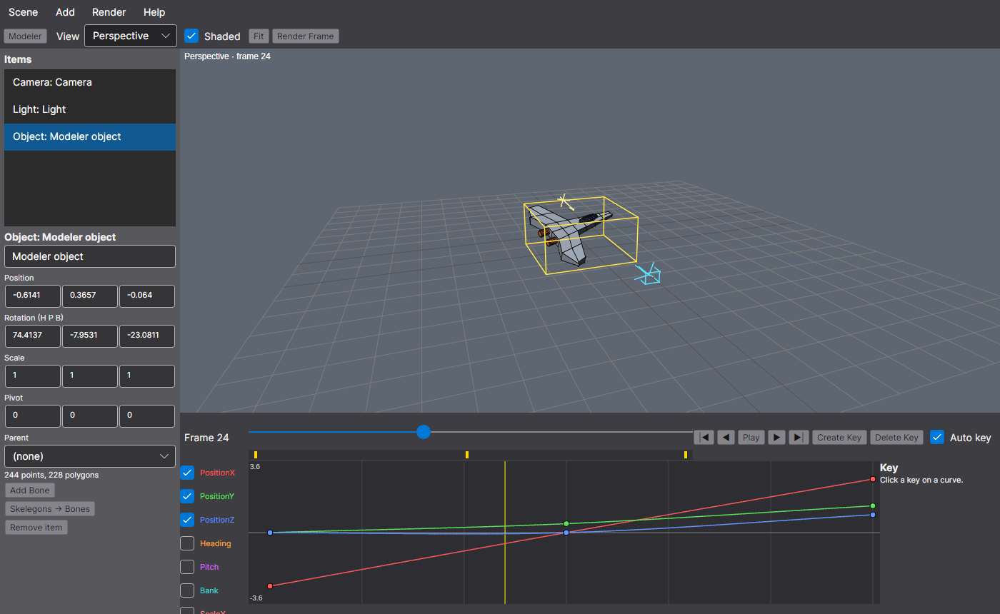

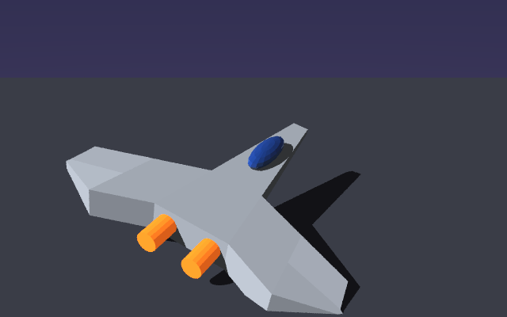

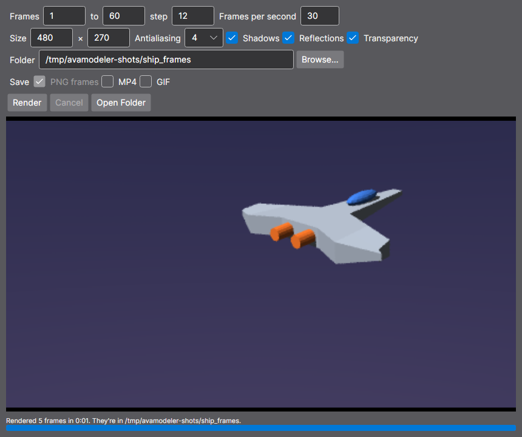

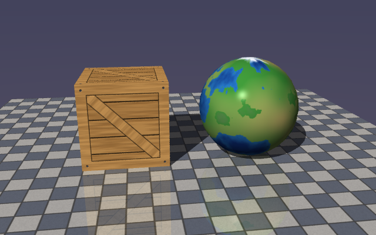

## Download and run

Ready-to-run builds for Windows, macOS and Linux, on both Intel/AMD and ARM, are on the
[Releases page](https://github.com/Harlock123/AVAModeler/releases/tag/latest). **Latest build** is rebuilt on every
push to `main`. Each download is one self-contained executable: no .NET install is needed.

| Platform | Archive |
|---|---|
| Windows | `AVAModeler-win-x64.zip`, `AVAModeler-win-x86.zip`, `AVAModeler-win-arm64.zip` |
| macOS | `AVAModeler-osx-arm64.tar.gz` (Apple silicon), `AVAModeler-osx-x64.tar.gz` (Intel) |
| Linux | `AVAModeler-linux-x64.tar.gz`, `AVAModeler-linux-arm64.tar.gz`, `AVAModeler-linux-arm.tar.gz` |

```bash
tar -xzf AVAModeler-linux-x64.tar.gz     # or linux-arm64, linux-arm, osx-arm64, osx-x64
./AVAModeler                             # or ./AVAModeler spaceship.lwo
```

On Windows, unzip and run `AVAModeler.exe`. On macOS, if Gatekeeper refuses to open it, run
`xattr -d com.apple.quarantine AVAModeler` once.

## Using it

| | Mouse | Keys |
|---|---|---|
| Select | Click; drag a box; right-drag a lasso (Shift adds, Ctrl removes) | Space cycles Points / Polygons / Volume / Edges; `/` deselect; `'` invert; `]` connected |
| Use a tool | Pick it from the tab (or its key), then drag in a view; Shift keeps to one axis | Enter keeps the result, Esc throws it away |
| Navigate | Wheel zooms; middle-drag or Alt-drag pans; drag the perspective view to turn it; double-click to maximize | A fit all, Shift+A fit selected, `.` and `,` zoom, 0 maximize, U the UV view |
| Layers | The layer buttons (top half foreground, bottom half background) | 1–9 foreground, Shift adds, Alt background, `\` swaps |
| Edit | | Ctrl+Z undo, Ctrl+Shift+Z redo, X cut, C copy, Ctrl+V paste, Delete remove; in Layout, Ctrl+Z undoes the scene, Ctrl+Shift+Z or Ctrl+Y redoes |
| Workspaces | | F1 Modeler, F2 Layout, F9 render a frame and F10 an animation (in Layout) |
| Files | | Ctrl+N new, Ctrl+O open, Ctrl+S save, Ctrl+Q quit (File › Quit) |

The default tool keys follow the classic layout: T Move, Y Rotate, H Size, Shift+H Stretch, Shift+X Box, Shift+O
Ball, Shift+C Disc, P Make Polygon, F Flip, M Merge Points, E Extrude, L Lathe, V Mirror, B Bevel, Tab MetaNURBS.
Help › Keyboard lists them all, and Edit › Preferences changes any of them.

## Driving AVA Modeler from an AI agent

AVA Modeler is an [MCP](https://modelcontextprotocol.io) server, so an AI agent (Claude Code, or any MCP client) can
model with it the way a person does: it runs the same tools with the same parameters, through the same command layer
the menus and Lua macros use, and every step is one undo step. It can then put what it modeled in a Layout scene,
light it, animate it and render it. It doesn't move the mouse or click: it calls the tools. It sees its work by asking
for pictures of the views, Layout's view, or ray-traced frames.

There are two ways to run it, both from the same program:

- **Headless**: `AVAModeler --mcp` serves MCP on stdin and stdout with no window. The agent's client starts it as a
  command; it has an object and a scene of its own and saves files in its working folder.
- **Live**: `AVAModeler --mcp --attach` connects the agent to the AVA Modeler open on your desktop. Everything it
  does happens in the open object and in Layout's scene: you watch it appear in the views, your edits and its edits
  to the object share one undo history, and Ctrl+Z undoes its steps (in Layout, its scene steps). Its scene changes go to Layout's scene whether or
  not Layout is on screen (the window isn't switched for you; F2 shows it), and Layout's item list follows them. Turn it on with **Macros › Allow AI Agents (MCP)** (or in Edit › Preferences;
  it's off until you do). The app then listens on a local pipe (a Unix domain socket on Linux and macOS, a named pipe
  on Windows) that only your own user account can open, so nothing on the network or from another account can
  connect. If the app isn't open, or agents aren't allowed, the agent's calls say so and say how to turn it on; the
  bridge reconnects by itself once the app is there. While you have a tool armed or a dialog box open, an agent's call
  waits (up to 20 seconds) for you to finish rather than change things under you.

Options: `--root FOLDER` sets the working folder (the current folder by default), which `open`, `save`, the scene
files and texture paths start from; files stay inside it, only formats AVA Modeler knows are read and written, and a
file is never written over unless asked to. `--no-plugins` skips the plugins folder.

### Setting up Claude Code

Use the downloaded program (or a build: `dotnet build -c Release`, then `src/AVAModeler/bin/Release/net10.0/AVAModeler`).
Don't use `dotnet run` for an MCP server: it prints build messages to the same stream.

```bash
claude mcp add avamodeler -- /path/to/AVAModeler --mcp                  # headless
claude mcp add avamodeler-live -- /path/to/AVAModeler --mcp --attach    # the open app
```

Or, for everyone working in a folder, in its `.mcp.json`:

```json
{
  "mcpServers": {
    "avamodeler": { "type": "stdio", "command": "/path/to/AVAModeler", "args": ["--mcp"] },
    "avamodeler-live": { "type": "stdio", "command": "/path/to/AVAModeler", "args": ["--mcp", "--attach"] }
  }
}
```

### The tools an agent gets

| Tool | What it does |
|---|---|
| `list_tools`, `describe_tool` | Every modeling tool (built in and from plugins) by tab, and one tool's parameters: type, default, unit, limits, choices. Both come from the tools themselves. |
| `run_tool` | Runs a modeling tool with parameters by name, on the selection (or everything in the foreground), as one undo step; returns the point and polygon counts before and after, and the selection. |
| `add_points`, `add_polygons` | Builds geometry point by point in the current layer. |
| `set_selection_mode`, `select_points`, `select_polygons`, `select_box`, `select_all`, `select_none`, `select_invert`, `select_connected` | The selection. |
| `set_layers` | The foreground and background layers. |
| `copy_layer` | Copies a layer into an empty one, points in the same order: the start of a morph target. |
| `undo`, `redo`, `new`, `open`, `save` | The history and files. |
| `set_surface`, `set_texture`, `remove_textures`, `make_uvs`, `set_uv_map` | Surfaces, image textures and UV maps. |
| `run_lua` | Runs a Lua macro as one undo step, returning what it printed. |
| `get_document`, `get_points`, `get_polygons` | Reads the object: layers, bounds, surfaces, UV maps, selection, history; points and polygons a page at a time. |
| `render_view` | A PNG of the top, front, side or perspective view, as the app draws it (wireframe, shaded or textured). |
| `render` | A ray-traced PNG of the object, lit and framed. |

The Layout tools:

| Tool | What it does |
|---|---|
| `get_scene`, `get_keys` | Reads the scene at a frame: the frame range and rate, the current camera, ambient light, backdrop and fog; every item's kind, name, parent, position, rotation, scale, settings and animated channels; an object's world bounds; load warnings. And an item's keys, channel by channel, with their TCB settings and end behaviours. |
| `new_scene`, `open_scene`, `save_scene` | Scene files in the working folder: the native `.avascene` (meshes inside it by default) and LightWave `.lws` (objects by their files; the warnings say what it drops). |
| `add_object` | The Modeler's object, live (later modeling shows in the scene), one of its layers, or an object file. |
| `add_light`, `add_camera`, `add_null`, `add_bone`, `remove_item` | Distant, point and spot lights with colour, intensity, cone, range and shadows; cameras by zoom factor or field of view; nulls; bones that bend an object. Lights and cameras can be aimed at a point as they're added. |
| `set_item` | An item's name, parent, pivot, visibility and its own settings (a light's, a camera's, an object's shadows, a bone's rest pose, strength and activity, with Rest Here and resetting its pose). |
| `add_morph`, `set_morph`, `remove_morph` | Morph targets: a copy of a Modeler layer with the object's points in the same order (a mismatch is refused, saying why), blended by a weight channel, `morph.<name>`. |
| `add_displacement`, `set_displacement`, `remove_displacement` | Wave and ripple displacements: points move along an axis by a travelling sine wave, its amplitude a channel, `displacement.<number>.amplitude`. |
| `skelegons_to_bones` | Layout's Skelegons → Bones: a bone for each 2-point polygon on a "Skelegon…" surface, chained where one's base is on another's tip. |
| `set_transform`, `look_at` | Position, rotation and scale at a frame, as keys or as plain values (the rule is in the tool's description); turning anything to face a point or another item. |
| `set_key`, `delete_key`, `set_end_behavior` | One key on one channel with tension, continuity, bias and the linear flag; removing keys; what a channel does before its first key and after its last. |
| `set_scene` | The frame range and rate, ambient light, the backdrop (a colour or a gradient), fog, the current camera and the current frame. |
| `undo_scene`, `redo_scene` | Layout's undo and redo, on the history the person's Ctrl+Z uses: each scene call is one step ("Agent: …"), and the person's steps can be undone too. |
| `render_scene_view` | A quick picture as Layout's view draws it, through the camera or from above, the front, the side or an orbit, with the lights, cameras, nulls and bones drawn; it also says where each item landed in the picture. |
| `render_scene`, `render_animation` | A ray-traced frame through a camera; or a run of frames written as numbered PNGs in the working folder, with a contact sheet back, and optionally joined into an MP4 or a looping GIF (with ffmpeg). Both are bounded in size and time. |

The agent is told the conventions when it connects: metres; LightWave's left-handed space with +X right, +Y up and +Z
away from you in the Front view; faces seen from the side where their points run clockwise; layers numbered 1 to 10
as the app's buttons show them, and points and polygons counted from 0; colours as [r, g, b] from 0 to 255
everywhere, for surfaces, lights and the scene alike. Scene channels are named as `get_keys` lists them:
`position.x` to `scale.z`, `heading`, `pitch`, `bank`, a light's `intensity`, a camera's `zoom`, an object's morph
weights (`morph.Smile`: 0 is the base shape, 1 the target) and displacement amplitudes (`displacement.1.amplitude`,
numbered from 1). A morph target is made from a copy of the base layer (`copy_layer`) changed only by moving points, and
the object goes in the scene by its own layer, so the target's layer isn't merged into it. A skelegon is a 2-point
polygon on a surface whose name starts with "Skelegon": its first point is the bone's base, its second the tip, and
one whose base is on another's tip becomes its child. A mistake (an unknown tool, a bad value, an index that isn't there) comes back as an error
that says what was wrong, and changes nothing.

A short session, as an agent might run it (the table in the picture above):

```text
add_points    {"points": [[0.03,0,0], [0.045,0.05,0], [0.03,0.2,0], [0.025,0.6,0], [0.04,0.68,0], [0.04,0.7,0]]}
add_polygons  {"polygons": [[0,1], [1,2], [2,3], [3,4], [4,5]], "surface": "Wood"}      # a leg's profile, as lines
run_tool      {"name": "Lathe", "params": {"Axis": "Y", "Center": [0,0,0], "Sides": 16}}
run_tool      {"name": "Array", "params": {"CountX": 2, "CountZ": 2, "Spacing": [1.5,1,0.8]}}
run_tool      {"name": "Move",  "params": {"Offset": [-0.75,0,-0.4]}}
run_tool      {"name": "Box",   "params": {"Center": [0,0.725,0], "Size": [1.8,0.05,1], "Surface": "Top"}}
set_surface   {"name": "Wood", "color": [125,78,42], "smoothing": true, "assign": false}
render_view   {"view": "perspective"}                                                  # look at it
save          {"path": "table.lwo"}
```

And then a scene: the table under a warm spotlight, the camera swinging half round it over 60 frames, frame 30 rendered.

```text
add_object        {"name": "Table"}                                                    # the Modeler's object, live
add_light         {"type": "spot", "name": "Warm", "position": [2,3,-2], "look_at": [0,0.4,0],
                   "color": [255,204,140], "intensity": 1.3, "cone_angle": 35}
set_item          {"item": "Light", "intensity": 0.4}                                 # the default light as a fill
set_transform     {"item": "Camera", "frame": 1, "position": [0,1.5,-4], "key": true}
look_at           {"item": "Camera", "target": "Table", "frame": 1, "key": true}
set_transform     {"item": "Camera", "frame": 30, "position": [4,2,0], "key": true}
look_at           {"item": "Camera", "target": "Table", "frame": 30, "key": true}
set_transform     {"item": "Camera", "frame": 60, "position": [0,1.5,4], "key": true}
look_at           {"item": "Camera", "target": "Table", "frame": 60, "key": true}
render_scene_view {"view": "camera", "frame": 30}                                      # quick check of the framing
render_scene      {"frame": 30, "width": 480, "samples": 4}                            # look at it
render_animation  {"step": 6, "width": 160}                                            # frames/frame0001.png… and a contact sheet
save_scene        {"path": "table.avascene"}
```

A complete example is `samples/mcp/carbon_atom.py`: a stylized carbon atom, six white protons and six grey neutrons
in a nucleus with six green electrons whizzing round it on three crossed orbits, modeled, staged, lit and animated
entirely through MCP calls. It needs only Python, as it carries the little MCP client it uses.

```bash
python3 samples/mcp/carbon_atom.py                # headless: writes carbon.lwo, carbon.avascene and carbon.png
python3 samples/mcp/carbon_atom.py --live         # in the open app, with Allow AI Agents on: watch it build
python3 samples/mcp/carbon_atom.py --movie        # also renders it as carbon.mp4 and carbon.gif (needs ffmpeg)
```

The files it writes are in `samples/mcp` too: open `carbon.avascene` in Layout and press Play, or watch
[`carbon.mp4`](samples/mcp/carbon.mp4), the 4-second animation, which loops without a jump.
`--movie` ray-traces all 120 frames with `render_animation`, in batches that each fit its limit, then joins them with
ffmpeg into the MP4 and the looping GIF below.

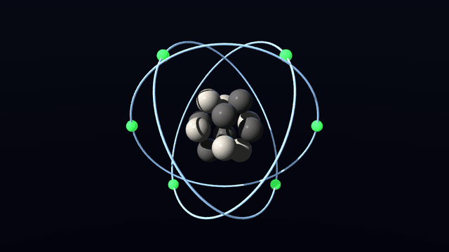

### Recipes (MCP prompts)

The server also offers saved recipes as MCP prompts (in Claude Code, `/` lists them as
`/mcp__avamodeler__lathed_vase` and so on): short step-by-step plans, each step with its exact tool call, that take
arguments such as a size, a colour or a frame count. The tests follow every one, call by call, so they stay correct.

| Prompt | What it makes |
|---|---|
| `lathed_vase` | A vase: a profile drawn with `add_points` and `add_polygons`, lathed round Y. |
| `table` | A table: a lathed leg cloned to the four corners, under a box top. |
| `chess_pawn` | A chess pawn, lathed from one profile. |
| `three_point_lighting` | Key, fill and rim lights aimed at an item. |
| `turntable_render` | The object on a null turning 360° over N frames, a camera, three-point lighting, and `render_animation` with a movie. |
| `bouncing_ball` | A ball bouncing on a floor, with squash and stretch through its scale keys. |
| `carbon_atom` | The carbon atom of `samples/mcp/carbon_atom.py`. |
| `morph_smile` | A smiley badge whose mouth smiles, through a morph keyed on `morph.Smile`. |
| `wave_flag` | A flag waving on its pole, through a travelling wave displacement with a keyed amplitude. |

## Building and testing

```bash
dotnet build AVAModeler.slnx
dotnet run --project src/AVAModeler
dotnet test AVAModeler.slnx
```

It needs the .NET 10 SDK. 560 tests cover every layer:

| Tests | Count | What they cover |
|---|---|---|
| Core | 41 | Math, the mesh and its edge maps, layers, selection modes, undo and grouped edits; UV maps through edits and undo, every projection's maths, image sampling and tiling, PNG and BMP reading, finding images |
| Formats | 68 | LWOB byte-identical round trips (textures included), LWLO layers, detail polygons, LWO2 (UV maps, seams and image blocks), GEO, OBJ (`vt` and .mtl maps), image paths, malformed files |
| Geometry | 79 | Booleans and drills (exact volumes, watertight results, UVs kept), subdivision, the Multiply algorithms, triangulation |
| Rendering | 31 | The four views' projections; a document as the views draw it; the OpenGL camera matrix landing every point where the software one does; shading, smoothing, picking; textures, with the OpenGL renderer's textured picture checked against the software one (on a real OpenGL or OpenGL ES context where there is one) |
| Tools | 62 | Every tool, the numeric parameters and their checks, the command API, Lua macros (and their time limit), a plugin loaded from its own assembly, the spaceship and logo built from scratch; Make UVs, UVs through every kind of edit, the UV space, the texture commands |
| Scene | 144 | Transforms, TCB envelopes, cameras, lights, LWS v1/v3 and JSON scenes, bones, morphs, the ray tracer and its textures, filtering and bump maps; scene snapshots (morph and displacement settings included) and copies, aiming an item at a point, object paths relative to the scene |
| Layout | 27 | Layout's session without its controls: how values become keys (the controls' and agents' alike), the modified flag, loading and saving scenes, looking through a camera, what the views draw; undo and redo of every kind of step, a drag as one step, the depth limit, clearing on a new or loaded scene, undoing back to the saved scene; rendering animations (numbering and step, progress, cancelling, the scene copy) and joining them into movies with ffmpeg (its arguments, finding it, doing without it, and a real MP4 and GIF where it's installed) |
| Mcp | 61 | Every MCP tool group with its errors and undo, the Layout tools included (unknown items and channels, frames out of range, paths outside the working folder, a failed call leaving the scene as it was and no undo step, undo_scene and redo_scene on the shared history, the look-at maths, keys read between frames); morphs (targets copied, mismatches refused, weights keyed), displacements (the wave's maths, renumbering), skelegons → bones and bones' rest settings, each undone; render_animation's movies (with ffmpeg, and without it); every recipe (prompt) followed call by call through the server and its result checked; whole agent sessions building a table and then staging, animating, rendering, saving and reopening a scene; the live mode through a pipe and the bridge, its UI-thread marshalling, the person's undo taking back an agent's scene step, and its waiting for a busy person; the built app as an MCP server and as a bridge, as real processes |
| UI | 47 | The window, mouse and keyboard driven through a headless window, the UV view, the texture panel, Layout (its Ctrl+Z, Ctrl+Shift+Z and Ctrl+Y, and Edit › Undo and Redo) and its Render Animation window, an AI agent working in the open window and in its Layout scene, and the screenshots |

The screenshots are drawn by the tests in a real (headless) window:

```bash
AVAMODELER_SHOTS=$PWD/Images dotnet test tests/AVAModeler.UI.Tests --filter Screenshot
```

## How it's built

Core, Geometry and Tools carry no UI, so tools are tested without a window, scripts and AI agents drive them, and
Layout reuses them.

| Project | What's in it |
|---|---|
| `AVAModeler.Core` | Double-precision math, the mesh (indexed points and n-gon polygons, with lazy edge and adjacency maps, and UV maps), layers, surfaces and their texture layers, the projections, texture images (PNG and BMP read here), selection, undo (copy-on-write snapshots of the layers an edit changes), the document |
| `AVAModeler.Formats` | LWOB/LWLO read and write, LWO2 read, VideoScape GEO, OBJ |
| `AVAModeler.Geometry` | Triangulation (LibTessDotNet), BSP booleans and drills, Catmull–Clark subdivision, the extrude/lathe/bevel family |
| `AVAModeler.Tools` | The tool framework and every tool, Make UVs and UV space, the command API, Lua macros (MoonSharp), plugins, SkiaSharp image reading |
| `AVAModeler.Rendering` | `IRenderer`, the software and OpenGL renderers and their shared texturing, the view cameras, picking |
| `AVAModeler.Scene` | Layout: the scene graph, envelopes, cameras, lights, bones, LWS and JSON scenes, the ray tracer |
| `AVAModeler.Layout` | Layout's state without its controls (the scene being worked on, its frame and chosen item, its undo history, scene files, what the views draw, rendering animations and joining them into movies with ffmpeg), shared by the Layout workspace and the MCP server |
| `AVAModeler.Modeler.UI` | The Modeler workspace: the quad view, tool tabs, numeric panel, layers, surface editor, preferences |
| `AVAModeler.Layout.UI` | The Layout workspace: the scene view, items, timeline, graph editor, render and animation windows |
| `AVAModeler.Mcp` | The MCP server for AI agents: the Modeler and Layout tool handlers (shared by both modes), the headless host, the live host and its local-pipe listener, and the `--attach` bridge |
| `AVAModeler` | The application: one window hosting both workspaces |

## Known limits

- **The OpenGL renderer** is off by default. The software renderer draws the same picture and is fast enough for
  models of tens of thousands of polygons. The OpenGL path's camera is tested against the software one point for
  point, but it hasn't been tried on every GPU and driver; if a context can't be had, the views fall back to software.
  Layout's view is drawn in software.
- **Booleans** use floating-point BSP: reliable on everyday shapes, but faces that are nearly (not exactly) coplanar
  can leave slivers. Both solids should be closed and face outward. Coplanar pieces of different faces stay separate
  (Merge Polygons tidies them).
- **Byte-identical LWOB round trips** are tested on hand-built files covering every chunk type. Files with more than
  one SRFS chunk, or a repeated PNTS/POLS in a layer, read correctly but are rewritten in the standard order.
- **Bevel** works per face, as LightWave 5's did (there's no group bevel). The camera view in Layout shows heading and
  pitch, not bank.
- **Textures**: the views show colour layers (up to four a surface); the other channels and bump maps show in the
  ray tracer. Cylindrical and spherical maps are worked out per corner in the views (and exactly per pixel in the ray
  tracer), so a big face can differ slightly. Procedural textures from LWOB files are kept but not drawn, and LWO2's
  procedural, gradient and front-projection layers are skipped. LWOB has nowhere for a layer's blending mode, so it
  isn't saved there (the native .avascene keeps it). Tools that make new geometry from nothing (Box, Text and so on)
  leave it without UVs, and a swept wall takes its edge's UVs at both ends rather than new ones.

- **Render Animation** needs ffmpeg on the PATH for MP4 and GIF (it isn't bundled); without it, the PNG frames are
  still written. Frames are numbered from 1 in the order rendered, not by scene frame. It renders frames one after
  another (each one multithreaded), with no motion blur or field rendering.

- **Layout's undo** covers the scene only: not the object's geometry (that's the Modeler's undo), the current frame or
  which item is chosen. A morph target's mesh is kept by reference, so to be undoable it is replaced rather than
  edited in place. The depth is a fixed 100 steps (the Undo Levels preference is the Modeler's).
- **AI agents (MCP)**: Points and Drag work only with the mouse, so agents use `add_points` and Move instead.
  `undo_scene` can't go back across `new_scene` or `open_scene`, which clear the scene's history.
  `render_animation`'s movie joins only that call's frames, so a movie longer than its limit (120 frames, 20 million
  rays) needs ffmpeg run by hand on the frames. `render_scene_view`'s camera view, like Layout's, doesn't show the
  camera's bank. `render` uses a fixed camera rig and
  lights round the object. Only one AVA Modeler per user takes agents at a time. Inside `run_lua`, `undo()` and
  `redo()` aren't allowed (the macro is one undo step) and a macro stops after 30 seconds unless given longer. Texture
  image paths may point outside the working folder (they're only read). The live pipe is tested on Linux; Windows and
  macOS use the same .NET pipe code but haven't been tried.

## About and licence

AVA Modeler © 2026 Lonnie Watson, under the [MIT License](LICENSE).

LightWave is a trademark of its current owner, LightWave Digital. AVA Modeler is an independent project inspired by
classic LightWave Modeler; it isn't affiliated with or endorsed by its owners. It reads and writes the classic object
and scene formats for compatibility. Lua support uses MoonSharp; polygon triangulation uses LibTessDotNet; the views
use Avalonia, SkiaSharp and Silk.NET.
